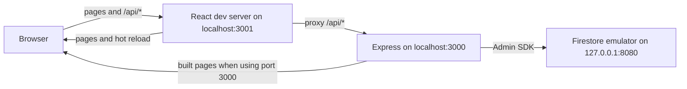
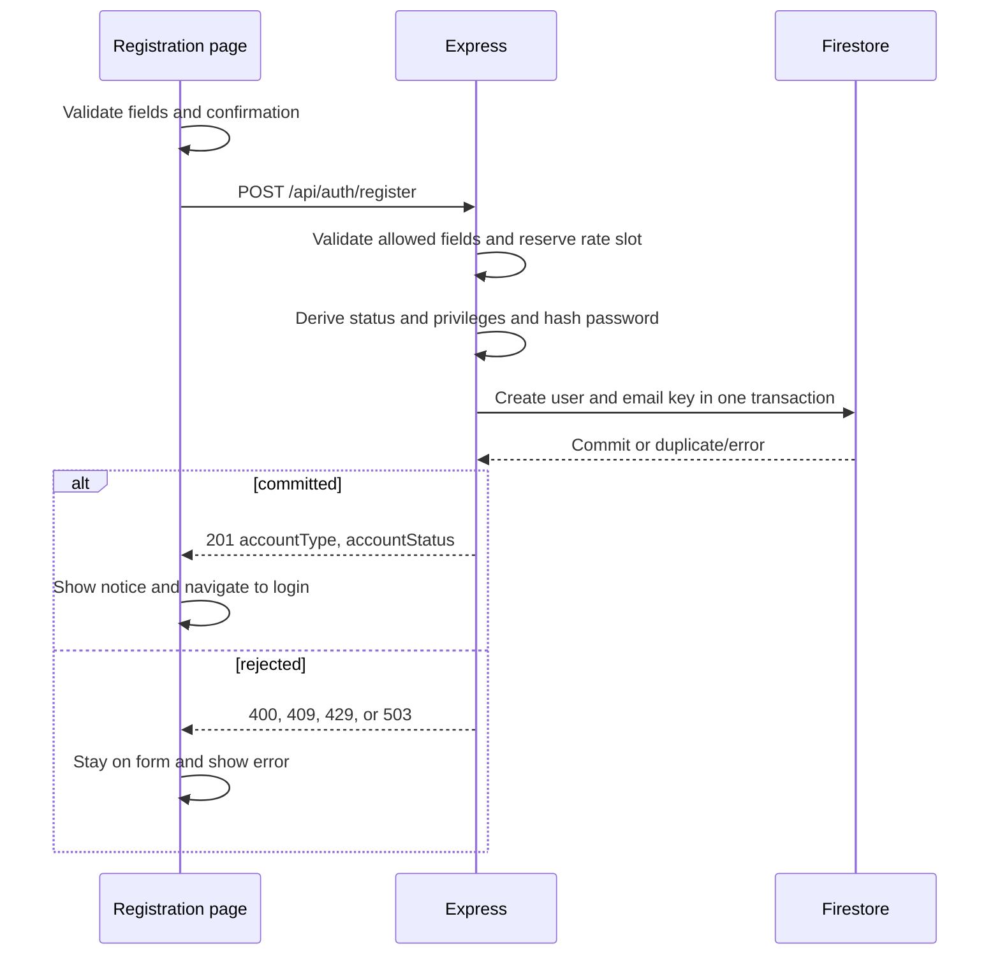
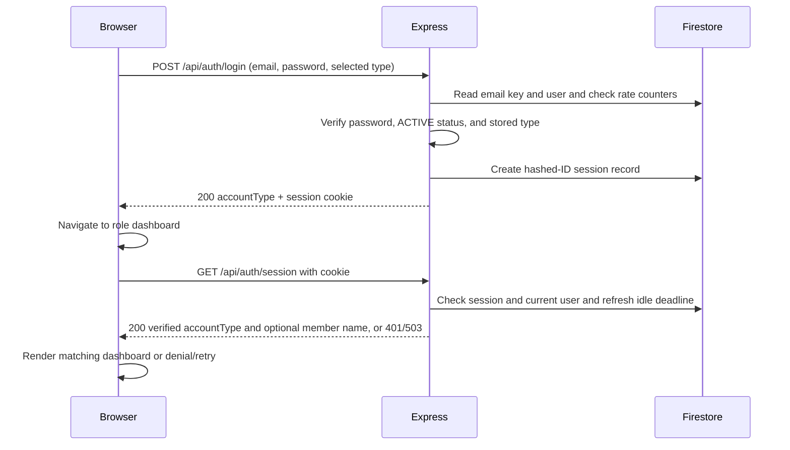

# Developer Guide

## Current application layout

`src/libconnect-mp4` contains the React and TypeScript frontend, the Express API, and the Firestore-backed authentication and Book catalog stores. Express serves the built frontend on the same origin as `/api/auth/*` and `/api/member/catalog`. During development, the React server provides hot reload and proxies API calls to Express. Authentication and catalog access run through Express with Firebase Admin and Firestore; the browser does not connect to Firestore directly.



## Running the development server

Install Node.js with support for `node --env-file` (Node 20.6 or newer), npm, and the Firebase CLI. Run the following commands from `src/libconnect-mp4` in PowerShell. Install the locked npm dependencies once:

```powershell
npm ci
```

Use three terminals. Start the local Firestore emulator first:

```powershell
firebase emulators:start --only firestore --project libconnect-mp4
```

For Express, create a local `.env` file in `src/libconnect-mp4` containing:

```dotenv
LIBCONNECT_FIRESTORE_MODE=local-emulator
LIBCONNECT_FIRESTORE_PROJECT_ID=libconnect-mp4
FIRESTORE_EMULATOR_HOST=127.0.0.1:8080
```

Keep `.env` out of Git and do not put production credentials in it. In the second terminal, wait until the emulator is listening on port 8080, then build the frontend and start Express on port 3000:

```powershell
node scripts/seed-local-books.js
npm run build
node --env-file=.env server/index.js
```

The seed command populates the local emulator with 120 sample Books and three BookCopy records per Book. It writes `books/{isbn}` and `bookCopies/{isbn}-01` through `-03`, creating only missing records. Rerunning it preserves existing Book data and copy statuses; new copies start as `AVAILABLE`. Run `node scripts/seed-local-books.js --dry-run` to see the target counts without connecting or writing. The seed is optional: an empty `books` collection makes the member catalog display “No books found.”

The `--env-file=.env` flag is required; `node server/index.js` does not load the file automatically. In the third terminal, run React with hot reload on port 3001:

```powershell
$env:PORT = '3001'
npm start
```

Open `http://localhost:3001/` for login or `http://localhost:3001/register` for registration. After signing in as an active Member, open `/member/dashboard` for the catalog. The React development server proxies `/api` requests to Express on port 3000. You can use `http://localhost:3000/` to view the built app without hot reload. Express uses only the local Firestore emulator, where accounts, sessions, rate counters, Books, and BookCopies are stored; emulator data can disappear when it stops. If the emulator, project settings, or frontend build are missing or wrong, Express stops before accepting requests. The [application README](../src/libconnect-mp4/README.md#local-development-with-the-firestore-emulator) also shows a setup using PowerShell environment variables instead of `.env`.

### Verify the local setup

From `src/libconnect-mp4`, run the regular tests and build:

```powershell
$env:CI = 'true'
npm test -- --watch=false --runInBand
npm run build
```

For the opt-in Firestore integration test, first start the emulator and set the three local Firestore variables shown above in the test terminal. Then run:

```powershell
$env:RUN_FIRESTORE_EMULATOR_TESTS = '1'
npm test -- --watch=false --runInBand --runTestsByPath test/firestore-mode.integration.test.js
```

## Registration and account records

The `/register` form accepts a Member or Librarian account. It collects name, email, password, and password confirmation; Librarian also requires a self-entered employee ID. The confirmation stays in the browser. Client validation gives field errors, and `POST /api/auth/register` repeats validation on the server. Registration email is trimmed and checked for one `@`, nonempty dot-separated segments, at least two domain labels, and no whitespace. The server accepts only the expected fields, uses an 8 KiB JSON limit, and limits registrations to five attempts per 15 minutes per direct source address.

The server hashes the exact password with Argon2id and generates the user ID, registration time, status, and privileges. In one Firestore transaction it creates `users/{userId}` and `emailKeys/{sha256(trimmed-lowercase-email)}`; a duplicate canonical email fails without a partial account. A Member starts `ACTIVE` with `memberId = userId`. A Librarian starts `INACTIVE` with `isManager = false` and needs manager activation before sign-in. No Manager registration option exists. A successful `201` contains only account type and status and creates no session. The page shows a success notice and returns to login after five seconds or via an immediate link.



## Login, sessions, and dashboard access

The login form posts email, password, and the selected Member or Librarian type to `POST /api/auth/login`. Express trims and lowercases the email for lookup, reads the email-key and user records, verifies the Argon2id hash, and requires an `ACTIVE` account whose stored type matches the selected type. A denied login returns a generic `401`. Login attempts are limited to five per canonical email and 30 per direct source address in a 15-minute window; storage errors return `503`.

On success, Express creates a Firestore `loginSessions` record and sends an HttpOnly, Secure, SameSite=Lax `__Host-libconnect_session` cookie. Firestore stores the hash of the session ID, not the raw cookie value. The `200` response contains the server-verified account type, which the client uses to navigate to `/member/dashboard` or `/librarian/dashboard`.

Every dashboard load calls `GET /api/auth/session` before rendering the dashboard. Express checks the cookie, session, current user status, and current role against the role recorded at session creation. For an active Member, the response can also contain the stored name, which the dashboard uses in its greeting. Sessions expire after 30 minutes idle or eight hours absolute; successful validation refreshes the idle deadline. A `401` sends the visitor to login, a verified role mismatch shows access denied with a link to the correct dashboard, and a service or network failure shows a retry state without dashboard content. The React route guard controls what is displayed; the member catalog API separately enforces its own server-side authorization on every request.



Logout first calls `GET /api/auth/csrf` to rotate and obtain a token, then sends that token in `X-CSRF-Token` with `POST /api/auth/logout`. Express compares the token hash, deletes the session, and clears the cookie on `204`. The UI returns to login after `204` or a confirmed unauthenticated `401`; on an unconfirmed error it hides dashboard content and offers a retry.

The local Firestore collections used by these flows are `users`, `emailKeys`, `loginSessions`, and `loginFailureCounters`. Only server code creates or changes their authentication records.

## Member Book catalog and search

The active Member dashboard at `/member/dashboard` shows the verified member's name when available, a sticky `LibConnect` navigation link, search controls, and Book cards. Each card shows the Book's title, author, and a visually shortened synopsis whose full text remains available to assistive technology. It has no synopsis expansion button or copy-availability claim. The catalog lists Book title records regardless of whether any physical copy is currently available.

Basic search checks whether the submitted text occurs anywhere in a title or author. **Advanced search** adds title, author, publisher, category, ISBN, synopsis, and inclusive minimum and maximum publication years. Text matching ignores case and surrounding whitespace. Populated advanced fields combine with each other and with the basic query using AND. Search runs on **Search** submission; **Clear search** restores the full catalog. Closing the advanced panel stops applying its criteria while retaining their values for reopening. Years must be whole numbers from 1450 through 2100, and the minimum cannot exceed the maximum.

The browser requests `GET /api/member/catalog` from Express, using its existing session cookie. Express revalidates the session and current active Member role on every request before reading `books`; Librarians and unauthenticated visitors receive no catalog data. The browser never queries Firestore directly. The endpoint is read-only and returns only card fields (`isbn`, `title`, `author`, `synopsis`) plus pagination and scan metadata. Book documents are keyed by ISBN and must contain nonempty `isbn`, `title`, and `author` strings and an integer `publicationYear`; malformed records are skipped. `bookCopies` is not read to decide which titles appear.

| API behavior | Contract |
| --- | --- |
| Filters | Optional `q`, `title`, `author`, `publisher`, `category`, `isbn`, `synopsis`, `minYear`, and `maxYear` query parameters. Text values are limited to 100 characters after trimming; years are four digits within 1450–2100. |
| Pagination | `pageSize` defaults to 100 and may be 1–100. Records are scanned in Book document-ID order. The response's `nextCursor` is passed back as `cursor` with the same filters and page size. The dashboard uses **Load more books** to reach later pages. |
| Success | `200` with `books`, `nextCursor`, `scannedAnyDocument`, `scannedValidBooks`, and `scanComplete`. These scan fields let the UI distinguish an empty collection from a search with no matches, including across pages. |
| Rejection or outage | `400` for an invalid query, `401` for an invalid session, `403` for a verified non-Member, and `503` when catalog storage or session validation fails. Errors contain a non-sensitive code and no Book data. |

An empty `books` collection displays “No books found.” A populated collection with no matches displays “No matching books.” A network or service failure displays a Retry action instead of either empty-state message. A search response that arrives after a newer search or reset cannot replace the newer results. The catalog's expected maximum is 1,000 Book documents; each API page reads at most 100 documents, so searches spanning the full collection require successive page requests. The local 120-Book seed exposes a second page for testing continuation.

## Running the production server

The Express server in `src/libconnect-mp4/server/index.js` serves the built React app and handles registration, login, sessions, rate counters, and the read-only member catalog. Deploy it on Cloud Run with a service account that has the Firestore permissions the app needs. Set these runtime environment variables to the **actual production Firebase project ID**:

```text
LIBCONNECT_FIRESTORE_MODE=production
LIBCONNECT_FIRESTORE_PROJECT_ID=<production-project-id>
GOOGLE_CLOUD_PROJECT=<same-production-project-id>
```

From `src/libconnect-mp4`, build the frontend and start the server with:

```sh
npm run build
node server/index.js
```

Cloud Run supplies `PORT` and `K_SERVICE`. Use its service account identity for credentials; do not set `FIRESTORE_EMULATOR_HOST` or `GOOGLE_APPLICATION_CREDENTIALS` in production. The server rejects a local gcloud Application Default Credentials file and checks that the Cloud Run metadata project matches `LIBCONNECT_FIRESTORE_PROJECT_ID` before it starts accepting requests. Missing or inconsistent configuration stops startup rather than switching Firestore targets.

Production deployment, service account permissions, and a live Firestore connection still need to be configured and verified. The repository contains no production project ID or credentials. Production mode is designed to fail on a developer laptop.

## Agent development workflow

The repository's [workflow guide](../workflow/README.md) defines the full agent handoff and evidence rules. Start from the current user request and the approved specification in `workflow/specs/`. The analyst prepares a dependency-ordered checklist and handoff under `workflow/tasks/<task-id>/`. A human approves the specification, then separately approves the checklist and handoff before implementation planning proceeds.

The orchestrator proposes consecutive **batches of up to two checklist items** and asks a human to approve the batch plan and implementation dispatch. A batch means one or two adjacent, unfinished items in checklist order; it is not a parallel group. For example, `T01`, `T02`, `T03`, `T04` become `T01 + T02` and `T03 + T04` when their dependencies and approval boundaries permit those pairs. A final item can form a one-item batch. If another item follows a one-item batch, the assignment records why the pair was split.

For each approved batch, the orchestrator assigns **one implementer** and **one different reviewer**. The implementer finishes and verifies the first item before starting the second. If an item is blocked or requires a new human decision, work stops at that boundary. The reviewer uses a separate worktree or clean checkout, checks each item's evidence and their combined behavior, and records a verdict for each item. The orchestrator reconciles the batch before starting the next one. A human makes the review and merge decision; neither an agent response nor a passing test grants approval.

The orchestrator records each assignment in `workflow/tasks/<task-id>/assignment-batch-<n>.json`. It runs the validator from the repository root before dispatch and after review (replace the example task ID and batch number with the approved ones):

```powershell
node src/workflow/validate-assignment.mjs workflow/tasks/example-task/assignment-batch-1.json plan
node src/workflow/validate-assignment.mjs workflow/tasks/example-task/assignment-batch-1.json complete
```

The `plan` check verifies ordering, batch size, assignment fields, and distinct implementer and reviewer identities. The `complete` check also verifies per-item evidence references and file presence. The validator does not run application tests, assess review findings, or grant approval. When changing the validator or manifest format, run `node --test workflow/validate-assignment.test.mjs`; its synthetic fixtures are in `workflow/test-fixtures/`.

To keep agent prompts small, handoffs point to approved artifact paths and versions instead of copying whole documents. Reports summarize results and link to factual logs in `logs/tasks/<task-id>/`. Keep per-item checks, failures, risks, and approval evidence. The workflow does not require agents to report or record token usage.

<script type="module">
  import mermaid from "https://cdn.jsdelivr.net/npm/mermaid@11/dist/mermaid.esm.min.mjs";

  const diagrams = [...document.querySelectorAll("pre > code.language-mermaid")];
  const nodes = diagrams.map((code) => {
    const node = document.createElement("div");
    node.className = "mermaid";
    node.textContent = code.textContent;
    code.parentElement.replaceWith(node);
    return node;
  });

  mermaid.initialize({ startOnLoad: false });
  await mermaid.run({ nodes });
</script>
