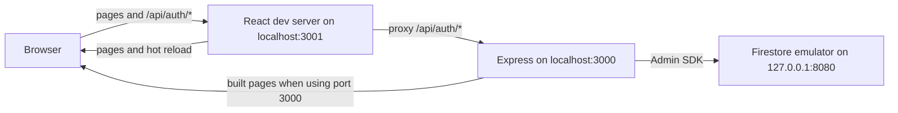
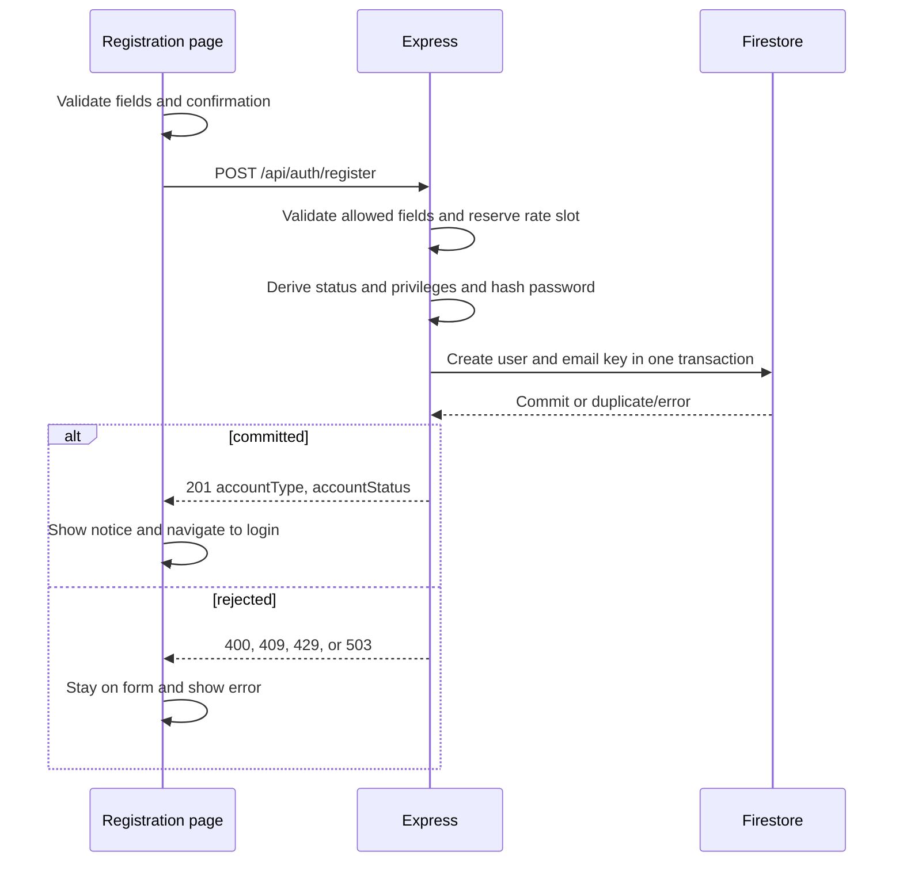
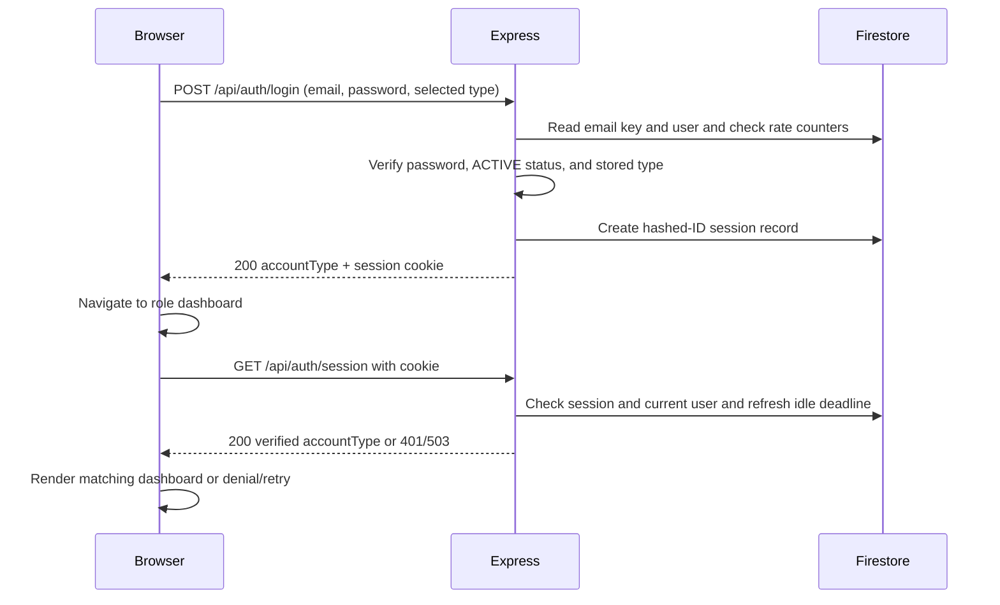

# Developer Guide

## Current application layout

`src/libconnect-mp4` contains the React and TypeScript frontend, the Express API, and the Firestore-backed authentication store. Express serves the built frontend on the same origin as `/api/auth/*`. During development, the React server provides hot reload and proxies API calls to Express. Authentication is implemented by Express with Firebase Admin and Firestore; the browser does not use Firebase Authentication to sign in or write account records.



## Running the development server

Install Node.js with support for `node --env-file` (Node 20.6 or newer), npm, and the Firebase CLI. Run the following commands from `src/libconnect-mp4` in PowerShell. Install the locked npm dependencies once:

```powershell
npm ci
```

Use three terminals. Start the local Firestore emulator first:

```powershell
firebase emulators:start --only firestore --project libconnect-mp4
```

For Express, create a local `.env` file in `src/libconnect-mp4` containing:

```dotenv
LIBCONNECT_FIRESTORE_MODE=local-emulator
LIBCONNECT_FIRESTORE_PROJECT_ID=libconnect-mp4
FIRESTORE_EMULATOR_HOST=127.0.0.1:8080
```

Keep `.env` out of Git and do not put production credentials in it. In the second terminal, wait until the emulator is listening on port 8080, then build the frontend and start Express on port 3000:

```powershell
npm run build
node --env-file=.env server/index.js
```

The `--env-file=.env` flag is required; `node server/index.js` does not load the file automatically. In the third terminal, run React with hot reload on port 3001:

```powershell
$env:PORT = '3001'
npm start
```

Open `http://localhost:3001/` for login or `http://localhost:3001/register` for registration. The React development server proxies `/api` requests to Express on port 3000. You can use `http://localhost:3000/` to view the built app without hot reload. Express uses only the local Firestore emulator, where test accounts, email keys, sessions, and rate counters are stored; emulator data can disappear when it stops. If the emulator, project settings, or frontend build are missing or wrong, Express stops before accepting requests. The [application README](../src/libconnect-mp4/README.md#local-development-with-the-firestore-emulator) also shows a setup using PowerShell environment variables instead of `.env`.

### Verify the local setup

From `src/libconnect-mp4`, run the regular tests and build:

```powershell
$env:CI = 'true'
npm test -- --watch=false --runInBand
npm run build
```

For the opt-in Firestore integration test, first start the emulator and set the three local Firestore variables shown above in the test terminal. Then run:

```powershell
$env:RUN_FIRESTORE_EMULATOR_TESTS = '1'
npm test -- --watch=false --runInBand --runTestsByPath test/firestore-mode.integration.test.js
```

## Registration and account records

The `/register` form accepts a Member or Librarian account. It collects name, email, password, and password confirmation; Librarian also requires a self-entered employee ID. The confirmation stays in the browser. Client validation gives field errors, and `POST /api/auth/register` repeats validation on the server. Registration email is trimmed and checked for one `@`, nonempty dot-separated segments, at least two domain labels, and no whitespace. The server accepts only the expected fields, uses an 8 KiB JSON limit, and limits registrations to five attempts per 15 minutes per direct source address.

The server hashes the exact password with Argon2id and generates the user ID, registration time, status, and privileges. In one Firestore transaction it creates `users/{userId}` and `emailKeys/{sha256(trimmed-lowercase-email)}`; a duplicate canonical email fails without a partial account. A Member starts `ACTIVE` with `memberId = userId`. A Librarian starts `INACTIVE` with `isManager = false` and needs manager activation before sign-in. No Manager registration option exists. A successful `201` contains only account type and status and creates no session. The page shows a success notice and returns to login after five seconds or via an immediate link.



## Login, sessions, and dashboard access

The login form posts email, password, and the selected Member or Librarian type to `POST /api/auth/login`. Express trims and lowercases the email for lookup, reads the email-key and user records, verifies the Argon2id hash, and requires an `ACTIVE` account whose stored type matches the selected type. A denied login returns a generic `401`. Login attempts are limited to five per canonical email and 30 per direct source address in a 15-minute window; storage errors return `503`.

On success, Express creates a Firestore `loginSessions` record and sends an HttpOnly, Secure, SameSite=Lax `__Host-libconnect_session` cookie. Firestore stores the hash of the session ID, not the raw cookie value. The `200` response contains the server-verified account type, which the client uses to navigate to `/member/dashboard` or `/librarian/dashboard`.

Every dashboard load calls `GET /api/auth/session` before rendering the dashboard. Express checks the cookie, session, current user status, and current role against the role recorded at session creation. Sessions expire after 30 minutes idle or eight hours absolute; successful validation refreshes the idle deadline. A `401` sends the visitor to login, a verified role mismatch shows access denied with a link to the correct dashboard, and a service or network failure shows a retry state without dashboard content. The React route guard controls what is displayed; any future protected API must enforce its own server-side authorization.



Logout first calls `GET /api/auth/csrf` to rotate and obtain a token, then sends that token in `X-CSRF-Token` with `POST /api/auth/logout`. Express compares the token hash, deletes the session, and clears the cookie on `204`. The UI returns to login after `204` or a confirmed unauthenticated `401`; on an unconfirmed error it hides dashboard content and offers a retry.

The local Firestore collections used by these flows are `users`, `emailKeys`, `loginSessions`, and `loginFailureCounters`. Only server code creates or changes their authentication records.

## Running the production server

The Express server in `src/libconnect-mp4/server/index.js` serves the built React app and handles registration, login, sessions, and rate counters. Deploy it on Cloud Run with a service account that has the Firestore permissions the app needs. Set these runtime environment variables to the **actual production Firebase project ID**:

```text
LIBCONNECT_FIRESTORE_MODE=production
LIBCONNECT_FIRESTORE_PROJECT_ID=<production-project-id>
GOOGLE_CLOUD_PROJECT=<same-production-project-id>
```

From `src/libconnect-mp4`, build the frontend and start the server with:

```sh
npm run build
node server/index.js
```

Cloud Run supplies `PORT` and `K_SERVICE`. Use its service account identity for credentials; do not set `FIRESTORE_EMULATOR_HOST` or `GOOGLE_APPLICATION_CREDENTIALS` in production. The server rejects a local gcloud Application Default Credentials file and checks that the Cloud Run metadata project matches `LIBCONNECT_FIRESTORE_PROJECT_ID` before it starts accepting requests. Missing or inconsistent configuration stops startup rather than switching Firestore targets.

Production deployment, service account permissions, and a live Firestore connection still need to be configured and verified. The repository contains no production project ID or credentials. Production mode is designed to fail on a developer laptop.
