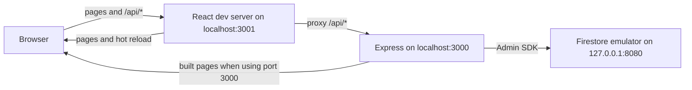
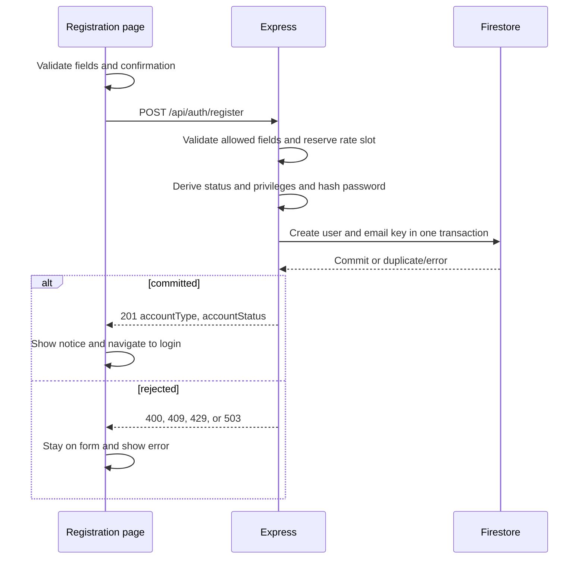
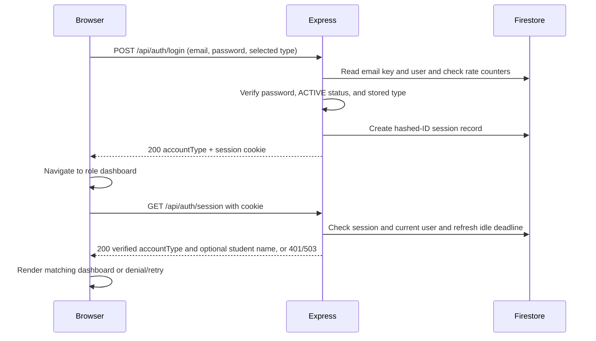

# Developer Guide

CodeClinic is a help desk for programming courses. Students submit coding
problems as tickets; TAs claim, answer, and resolve them; AI gives students
hints and helps TAs. `Overview.md` defines the product scope, and
`workflow/PLAN.md` orders the delivery work.

The project began with a library scope named LibConnect. Task evidence written
before 8 Nov 2026 still uses that name, the Member and Librarian account types,
and the former application path `src/libconnect-mp4`.

## Contents

- [Current application layout](#current-application-layout)
- [Running the development server](#running-the-development-server)
- [Registration and account records](#registration-and-account-records)
- [Login, sessions, and dashboard access](#login-sessions-and-dashboard-access)
- [Student ticket creation](#student-ticket-creation)
- [Running the production server](#running-the-production-server)
- [Design of shared components](#design-of-shared-components)
- [Security design](#security-design)
- [Environments and deployment](#environments-and-deployment)
- [Multi-agent development workflow](#multi-agent-development-workflow)
- [Context engineering and resource-aware use](#context-engineering-and-resource-aware-use)
- [Repository and workflow files](#repository-and-workflow-files)
- [Acknowledgements](#acknowledgements)

## Current application layout

`src/codeclinic` contains the React and TypeScript frontend (`src/`), the Express API (`server/`), and the tests (`test/`). Under `server/`, `auth/` holds registration, login, sessions, and the Firestore-backed authentication store; `shared/` holds the Firestore rate counter; and `ai/` holds the AI gateway's configuration, feature registry, prompt construction, secret redaction, rate limits, and usage store. The AI modules are not yet mounted on any route, so no AI feature is exposed. Express serves the built frontend on the same origin as `/api/auth/*`. During development, the React server provides hot reload and proxies API calls to Express. Authentication runs through Express with Firebase Admin and Firestore; the browser does not connect to Firestore directly.



## Running the development server

Install Node.js with support for `node --env-file` (Node 20.6 or newer), npm, and the Firebase CLI. Run the following commands from `src/codeclinic` in PowerShell. Install the locked npm dependencies once:

```powershell
npm ci
```

Use three terminals. Start the local Firestore emulator first:

```powershell
firebase emulators:start --only firestore --project demo-codeclinic
```

The `demo-` prefix marks an emulator-only project ID, so the Firebase tools cannot reach a cloud project with it. For Express, create a local `.env` file in `src/codeclinic` containing:

```dotenv
CODECLINIC_FIRESTORE_MODE=local-emulator
CODECLINIC_FIRESTORE_PROJECT_ID=demo-codeclinic
FIRESTORE_EMULATOR_HOST=127.0.0.1:8080
```

Keep `.env` out of Git and do not put production credentials in it. In the second terminal, wait until the emulator is listening on port 8080, then build the frontend and start Express on port 3000:

```powershell
npm run build
node --env-file=.env server/index.js
```

The `--env-file=.env` flag is required; `node server/index.js` does not load the file automatically. In the third terminal, run React with hot reload on port 3001:

```powershell
$env:PORT = '3001'
npm start
```

Open `http://localhost:3001/` for login or `http://localhost:3001/register` for registration. After signing in, a Student lands on `/student/dashboard` and a TA on `/ta/dashboard`. The React development server proxies `/api` requests to Express on port 3000. You can use `http://localhost:3000/` to view the built app without hot reload. Express uses only the local Firestore emulator, where accounts, sessions, and rate counters are stored; emulator data can disappear when it stops. If the emulator, project settings, or frontend build are missing or wrong, Express stops before accepting requests. The [application README](../src/codeclinic/README.md#local-development-with-the-firestore-emulator) also shows a setup using PowerShell environment variables instead of `.env`.

### Verify the local setup

From `src/codeclinic`, run the regular tests and build:

```powershell
$env:CI = 'true'
npm test -- --watch=false --runInBand
npm run build
```

For the opt-in Firestore integration test, first start the emulator and set the three local Firestore variables shown above in the test terminal. Then run:

```powershell
$env:RUN_FIRESTORE_EMULATOR_TESTS = '1'
npm test -- --watch=false --runInBand --runTestsByPath test/firestore-mode.integration.test.js
```

## Registration and account records

The `/register` form accepts a Student or TA account. It collects name, email, password, and password confirmation; TA also requires a self-entered employee ID. The confirmation stays in the browser. Client validation gives field errors, and `POST /api/auth/register` repeats validation on the server. Registration email is trimmed and checked for one `@`, nonempty dot-separated segments, at least two domain labels, and no whitespace. The server accepts only the expected fields, uses an 8 KiB JSON limit, and limits registrations to five attempts per 15 minutes per direct source address.

The server hashes the exact password with Argon2id and generates the user ID, registration time, status, and privileges. In one Firestore transaction it creates `users/{userId}` and `emailKeys/{sha256(trimmed-lowercase-email)}`; a duplicate canonical email fails without a partial account. A Student starts `ACTIVE` with `studentId = userId`. A TA starts `INACTIVE` with `isManager = false` and needs activation by a TA Coordinator before sign-in. No TA Coordinator registration option exists. Stored records that still hold the former `MEMBER` or `LIBRARIAN` types or a `memberId` are treated as malformed and fail closed. A successful `201` contains only account type and status and creates no session. The page shows a success notice and returns to login after five seconds or via an immediate link.



## Login, sessions, and dashboard access

The login form posts email, password, and the selected Student or TA type to `POST /api/auth/login`. Express trims and lowercases the email for lookup, reads the email-key and user records, verifies the Argon2id hash, and requires an `ACTIVE` account whose stored type matches the selected type. A denied login returns a generic `401`. Login attempts are limited to five per canonical email and 30 per direct source address in a 15-minute window; storage errors return `503`.

On success, Express creates a Firestore `loginSessions` record and sends an HttpOnly, Secure, SameSite=Lax `__Host-codeclinic_session` cookie. Firestore stores the hash of the session ID, not the raw cookie value. The `200` response contains the server-verified account type, which the client uses to navigate to `/student/dashboard` or `/ta/dashboard`. Express serves the frontend for only these two dashboard paths; the former `/member/dashboard` and `/librarian/dashboard` paths are not served or redirected.

Every dashboard load calls `GET /api/auth/session` before rendering the dashboard. Express checks the cookie, session, current user status, and current role against the role recorded at session creation. For an active Student, the response can also contain the stored name, which the dashboard uses in its greeting. Sessions expire after 30 minutes idle or eight hours absolute; successful validation refreshes the idle deadline. A `401` sends the visitor to login, a verified role mismatch shows access denied with a link to the correct dashboard, and a service or network failure shows a retry state without dashboard content. The guard accepts only a server-returned `STUDENT` or `TA` type; any other value shows the retry state. The React route guard controls only what is displayed; any future protected API must enforce its own server-side authorization on every request.

## Student ticket creation

The shipped ticket scope is create-only. `TicketCreatePage` is protected by the
session route guard at `/student/tickets/new`; the dashboard's **Ask for Help**
section and Student header link navigate to that route. The form validates
required text, the seven fixed language choices, up to five trimmed lowercase
unique tags, optional source context, and the approved text and byte limits.
Source context is either up to three inline code files or a public GitHub URL
with relative file paths. The browser requests a CSRF token and submits the
allowlisted fields to `POST /api/tickets`; it never reads or writes the ticket
collection directly.

The ticket router independently checks the cookie-backed session, reloads the
active Student account, checks CSRF, parses at most 128 KiB, and validates the
request. `createFirestoreTicketStore` generates the Firestore document ID and
writes one C1 `OPEN` document at `tickets/{ticketId}`. The stored record contains
the server-derived owner, Firestore `Timestamp` values, null initial claim and
resolution fields, and empty arrays/null values for absent optional fields.
Repository URLs are stored as references and are not fetched. Creation does
not create a persisted notification. A successful `201` lets the client return
to the Student dashboard with transient confirmation; failures remain on the
form. Ticket lists, details, edits, closes, replies, and TA transitions are
outside this implementation.

Focused UI, API, and storage checks are in `test/StudentTickets.test.tsx`,
`test/student-tickets.api.test.js`, and `test/student-tickets.storage.test.js`.
The storage test verifies the exact C1 document shape and Firestore timestamp
types; it uses a controlled Firestore interface. The task's local emulator
assertion is recorded separately in `workflow/tasks/student-tickets/implementation-T04.md`.



Logout first calls `GET /api/auth/csrf` to rotate and obtain a token, then sends that token in `X-CSRF-Token` with `POST /api/auth/logout`. Express compares the token hash, deletes the session, and clears the cookie on `204`. The UI returns to login after `204` or a confirmed unauthenticated `401`; on an unconfirmed error it hides dashboard content and offers a retry.

The local Firestore collections used by these flows are `users`, `emailKeys`, `loginSessions`, and `loginFailureCounters`. Only server code creates or changes their authentication records.

## Account management

The server mounts `server/account/routes.js` under `/api`. It provides
`GET /api/account`, `PATCH /api/account/profile`, `POST /api/account/password`,
and the list/status/password-reset endpoints under `/api/support/accounts`.
Every mutation requires the current server CSRF token. Authorization loads the
actor and target records; browser role and manager fields have no authority.
TAs support Students; Coordinators also support other TAs.

Email changes move the canonical `emailKeys` reservation atomically. Password
changes and support resets use Argon2id; a successful self-service change
preserves the caller's session and deletes the others. Deactivation and reset
delete the target's sessions. Reset returns a new 16-character temporary
password once with `Cache-Control: no-store`, stores only its hash, and sets
`mustChangePassword`.

Temporary-password sessions may access only session lookup, CSRF retrieval,
logout, and the own-password-change endpoint. Every other protected API,
including notifications, returns `403 PASSWORD_CHANGE_REQUIRED`. The browser
routes the owner to `/account/password-change` until the change succeeds.

Shared UI routes are `/student/account`, `/ta/account`, `/ta/students`,
`/ta/tas`, and `/account/password-change`. The Express server serves the SPA
shell for direct navigation and refresh. These pages add shared account
functionality; role-owned ticket and AI features remain separate tasks.

### First TA Coordinator

A human administrator first registers a TA account, then runs
`scripts/bootstrap-coordinator.js` with an explicit `--project` and supplies the
existing TA email through `CODECLINIC_COORDINATOR_EMAIL`. For local synthetic
data only, with the Firestore emulator already running:

```sh
FIRESTORE_EMULATOR_HOST=127.0.0.1:8080 CODECLINIC_COORDINATOR_EMAIL=existing-ta@example.test node scripts/bootstrap-coordinator.js --project demo-codeclinic
```

The script promotes the matching existing TA to `isManager: true` and `ACTIVE`.
It refuses a Student, missing account, or an existing Coordinator unless
`--allow-additional` is explicitly supplied. It prints outcomes without the
full email or credentials. Production bootstrap is a human administrator's
operation; agents do not run this script against a cloud project. Never reuse
production credentials for local development.

## Notifications

`server/notifications/notify.js` is the sole shared notification writer. Ticket
owners call `notify` from authorized server operations; the inbox has no
client-facing creation endpoint. Failed writes retry once and never roll back
the calling operation. Event/recipient decisions belong to the ticket tasks.

The four `/api/notifications` endpoints list the caller's notifications, count
unread items (maximum 99), mark one read, and mark all read. Mutations require
CSRF; another user's item ID returns the same `404` as a missing item. Messages
are plain text. `NotificationBell` appears in both dashboard navbars and
`/notifications` renders the session-checked inbox. A future role feature may
supply `NotificationInbox.ticketHref`; no ticket route is invented here.

The list query needs a Firestore composite index on `recipientUserId` ascending
and `createdAt` descending. That production prerequisite remains with the
Firebase/deployment owner; the local emulator does not enforce index creation.
The current task does not configure or deploy cloud indexes.

## Shared AI gateway

`server/ai/gateway.js` composes the approved units and exposes
`createAiGateway(deps)` with `register(definition)` and
`run({ feature, actor, input })`. The startup instance is available at
`app.locals.aiGateway`. Calling features must first authenticate and authorize
the actor and data in trusted server code. No real feature is registered and
no AI HTTP endpoint is exposed by this shared-work implementation.

Configuration is read once from the server environment. Missing or malformed
`SOCLAAS_API_KEY`, `SOCLAAS_BASE_URL`, or `SOCLAAS_MODEL` disables the gateway
without stopping the server. Tests use fakes. Do not place keys in browser
configuration or logs. Production configuration belongs to the deployment owner.

Calls reserve shared Firestore limits (5/user/minute, 50/user/day, and a global
default of 40/minute, configurable up to 45), redact common secrets and email
addresses, reject oversized input without truncation, and put fixed system
instructions before delimited user data. The provider transport has a
20-second attempt timeout, one bounded retry, a circuit breaker, redirect
refusal, and a 1 MiB response cap. Output must pass JSON and feature-schema
validation. Logs and `aiUsage` store metadata and numeric token counts only.

Redaction can miss secrets: users must never paste credentials. Model output
is advisory and cannot authorize writes or invoke tools. Real model selection
and `max_tokens` support still require a human smoke check; no live provider
call was made during automated verification.

## Running the production server

The Express server in `src/codeclinic/server/index.js` serves the built React app and handles registration, login, sessions, and rate counters. Deploy it on Cloud Run with a service account that has the Firestore permissions the app needs. Set these runtime environment variables to the **actual production Firebase project ID**:

```text
CODECLINIC_FIRESTORE_MODE=production
CODECLINIC_FIRESTORE_PROJECT_ID=<production-project-id>
GOOGLE_CLOUD_PROJECT=<same-production-project-id>
```

From `src/codeclinic`, build the frontend and start the server with:

```sh
npm run build
node server/index.js
```

Cloud Run supplies `PORT` and `K_SERVICE`. Use its service account identity for credentials; do not set `FIRESTORE_EMULATOR_HOST` or `GOOGLE_APPLICATION_CREDENTIALS` in production. The server rejects a local gcloud Application Default Credentials file and checks that the Cloud Run metadata project matches `CODECLINIC_FIRESTORE_PROJECT_ID` before it starts accepting requests. Missing or inconsistent configuration stops startup rather than switching Firestore targets.

Production deployment, service account permissions, and a live Firestore connection still need to be configured and verified. The repository contains no credentials. Production mode is designed to fail on a developer laptop.

## Design of shared components

Shared server code is split by responsibility so each feature reuses one implementation of each concern:

| Component | File | Responsibility | Used by |
| --- | --- | --- | --- |
| Firestore target selection | `server/firestore-target.js` | Chooses the emulator or production Firestore once at startup and fails closed on inconsistent configuration | `server/index.js` |
| Auth store | `server/auth/firestore-store.js` | Reads and writes users, email keys, sessions, and rate counters | Login, session checks, registration rate limits |
| Email canonicalization | `server/auth/email.js` (`canonicalizeEmail`, `emailKeyFor`) | One rule for email lookup keys | Login and registration |
| Registration persistence | `server/auth/firestore-registration.js` | Atomic user and email-key creation | Registration |
| Firestore rate counter | `server/shared/firestore-rate-counter.js` | Fixed-window counters stored in Firestore | Auth store and AI gateway rate limits |
| Shared theme | `src/theme.css` | Design tokens and reusable visual classes | Every page |
| Dashboard logout | `src/DashboardLogout.tsx` | One logout flow with CSRF handling | Both dashboards |
| AI gateway | `server/ai/` | Server-only configuration, redaction and caps, stable prompts, Firestore rate limits, bounded provider transport, schema validation, and safe usage records | Created at server startup; no real feature registered |
| Account support | `server/account/` | Own-profile/password updates and server-authorized support operations | Account and support pages |
| Notifications | `server/notifications/`, `src/notifications/` | Shared writer, own-user inbox API, bell and plain-text inbox | Both dashboards |

Known issue: `server/auth/login.js` still re-exports the email helpers from `server/auth/email.js` for one frontend test import. The re-export can be removed once that test imports `email.js` directly.

The remaining planned shared components, including role-specific AI integrations, are described in [`workflow/PLAN.md`](../workflow/PLAN.md#planned-design-details).

## Security design

Implemented security controls:

- The Express server is the only authority for identity, role, status, and manager privilege. Client-supplied roles, IDs, statuses, and manager flags are rejected or ignored.
- Passwords are hashed with Argon2id. Responses, logs, and test evidence never contain passwords, hashes, or session IDs.
- Sessions use a `__Host-` cookie that is HttpOnly, Secure, and SameSite=Lax, store only a hash of the session ID, expire after 30 minutes idle or eight hours, and recheck the account on every protected request.
- Logout requires a CSRF token.
- Login and registration are rate limited, and failures use generic messages that do not reveal whether an account exists.
- The browser never accesses Firestore directly.

No role-specific AI feature is exposed yet. The shared AI gateway is created once at server startup, including when configuration is missing; a disabled gateway returns `AI_UNAVAILABLE` while the rest of the server continues. Planned AI security controls are described in [`workflow/PLAN.md`](../workflow/PLAN.md#planned-design-details).

## Environments and deployment

Current state:

| Environment | Firestore target | Status |
| --- | --- | --- |
| Local development | Firestore emulator, project `demo-codeclinic` | Working |
| Production | `apphosting.yaml` configures Firebase App Hosting in `production` mode for project `libconnect-mp4` | Not verified |

The `.firebaserc` `default` alias is the emulator-only `demo-codeclinic`, and its `prod` alias is `libconnect-mp4`. There is no separate deployed development environment. The repository has no GitHub Actions workflow yet. The planned environments and deployment pipeline are described in [`workflow/PLAN.md`](../workflow/PLAN.md#planned-design-details).

## Multi-agent development workflow

Every non-trivial feature follows spec-driven development: **specify → plan/tasks → implement → review → human merge decision**, with an explicit human approval at each gate. Specialized agents are defined in `workflow/agents/`:

| Agent | Role | Configured model and effort |
| --- | --- | --- |
| `analyst` | Writes the specification, task checklist, and handoff | `gpt-6-luna`, medium |
| `orchestrator` | Coordinates test writing, ordered batches, implementers, and review; owns checklist updates | `gpt-6-sol`, high |
| `test_writer` | Writes tests from the approved specification before implementation | `gpt-6-luna`, medium |
| `implementer` | Implements one approved batch of up to two tasks in order and records evidence for each | `gpt-6-luna`, medium |
| `reviewer` | Independently reviews each batch item and their combined change from a separate worktree | `gpt-6-luna`, high |

The orchestrator proposes consecutive batches of up to two checklist items in dependency order and obtains human approval before dispatch. One implementer completes and verifies each item before starting the next; a different reviewer checks each item and their combined behavior before the next batch. Batch manifests under `workflow/tasks/<task-id>/` are checked by `src/workflow/validate-assignment.mjs`. Agents receive artifact paths rather than pasted documents, verify approval state before acting, and cannot approve their own work. The OpenSpec toolkit skills (`.agents/skills/openspec-*`) are installed. A path adapter maps them to `workflow/specs/` so the project keeps a single specification tree. `workflow/README.md` defines the lifecycle, handoff rules, permission matrix, and evidence requirements.

## Context engineering and resource-aware use

In the development process:

- **Paths instead of pasted documents:** handoffs pass artifact paths and versions, so agents read only the sections they need (`workflow/README.md`, *Context and evidence budget*).
- **One primary record per fact:** reports link to factual logs instead of copying them.
- **Model choice by role:** the orchestrator and reviewer run at high reasoning effort; routine roles run at medium.
- **Token usage records:** each subagent reports its token usage for the implementation report.
- **Skill pruning:** on 8 Nov 2026, nine skills unrelated to the stack (mobile, analytics, Data Connect, and others) were removed from `.agents/skills/`. This cut the skill descriptions loaded into every agent session from 7,269 to 4,446 characters (−39%) and removed about 361 KB of reference files. See `logs/tasks/codeclinic-scope/skills-pruning.md`.

In the app, no LLM calls exist yet. The planned prompt, caching, and token-budget approach is described in [`workflow/PLAN.md`](../workflow/PLAN.md#planned-design-details).

## Repository and workflow files

| Path | Contents |
| --- | --- |
| `AGENTS.md` | Repository-wide agent instructions: source-of-truth order, approval protocol, security baseline, and boundaries |
| `Overview.md` | Product scope, user stories, data model, and AI security constraints |
| `workflow/README.md` | Workflow lifecycle, task layout, context budget, handoff rules, and permission matrix |
| `workflow/PLAN.md` | Feature dependency order and ownership |
| `workflow/agents/*.toml` | Specialized agent profiles: mission, model, reasoning effort, and instructions |
| `workflow/specs/*.md` | Canonical feature specifications |
| `workflow/tasks/<task-id>/` | Per-task evidence: spec reference, `tasks.md` checklist, `handoff.md`, implementation and review reports, test coverage reports, security review, and visual evidence |
| `workflow/tasks/ai-gateway/design.md` | SoC LLM adapter design reused from MP3: provider contract, five-layer reliability pipeline, error handling, and the 90 requests/minute provider limit |
| `workflow/tasks/<task-id>/assignment-batch-*.json` | Orchestrator dispatch records for a task's batches |
| `src/workflow/validate-assignment.mjs` | Checks batch manifest structure and evidence paths; does not grant approval or verify test truth |
| `workflow/tasks/<task-id>/execution_logs/` | Legacy location for factual logs from earlier tasks |
| `logs/tasks/<task-id>/` | Factual execution logs: commands, results, and agent run notes |
| `logs/chat/<name>/` | Chat summaries produced with the `summarise-chat` skill and checked by the developer |
| `.agents/skills/` | Project skills: Firebase and Firestore references, OpenSpec SDD skills, Git conventions, and chat summarisation |
| `skills-lock.json` | Source and hash of each installed external skill |
| `openspec/` | OpenSpec toolkit configuration; specifications live in `workflow/specs/` instead |
| `docs/` | User Guide, Developer Guide, Reflections, and the GitHub Pages product website |

## Acknowledgements

- Workflow documents reused from the team's MP3:
  - `AGENTS.md` and the first version of `Overview.md` came from commit `72b0063` (*Add documentation from MP3*).
  - The SoC LLM adapter design in `workflow/tasks/ai-gateway/design.md` (provider contract, five-layer reliability pipeline, error handling, and the 90 requests/minute limit) was first written for MP3.
- Firebase skills in `.agents/skills/` come from [`firebase/agent-skills`](https://github.com/firebase/agent-skills), as recorded in `skills-lock.json`.
- The `openspec-*` skills were generated by the OpenSpec CLI (version 1.16.0, MIT licence).
- The product website uses the Jekyll [minima](https://github.com/jekyll/minima) theme, and the guides render diagrams with [Mermaid](https://mermaid.js.org/).
- Code and documentation were written with assistance from OpenAI Codex and Anthropic Claude, as recorded in `logs/`.

<script type="module">
  import mermaid from "https://cdn.jsdelivr.net/npm/mermaid@11/dist/mermaid.esm.min.mjs";

  const diagrams = [...document.querySelectorAll("pre > code.language-mermaid")];
  const nodes = diagrams.map((code) => {
    const node = document.createElement("div");
    node.className = "mermaid";
    node.textContent = code.textContent;
    code.parentElement.replaceWith(node);
    return node;
  });

  mermaid.initialize({ startOnLoad: false });
  await mermaid.run({ nodes });
</script>
