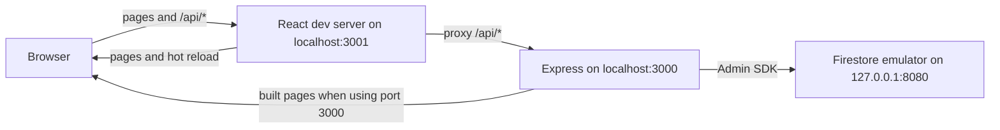
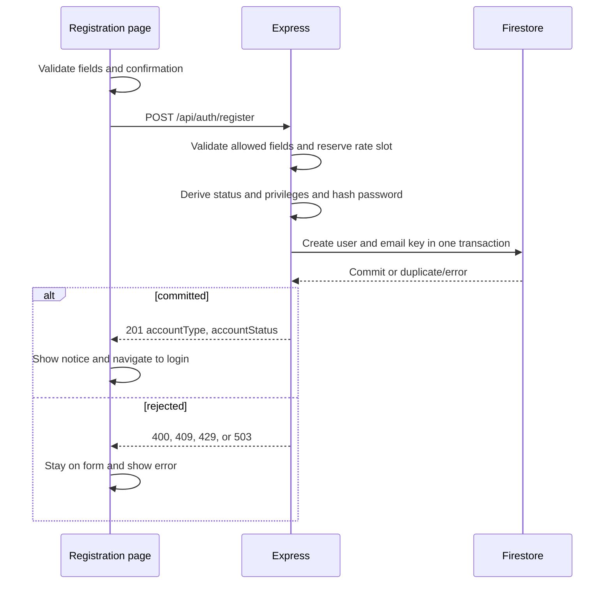
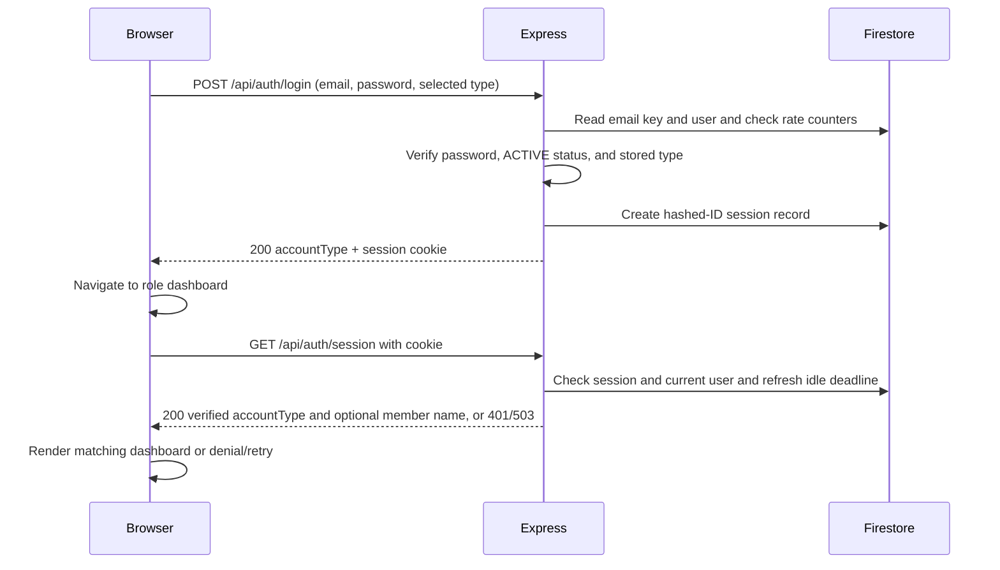

# Developer Guide

CodeClinic is a help desk for programming courses. Students submit coding
problems as tickets; TAs claim, answer, and resolve them; AI gives students
hints and helps TAs. `Overview.md` defines the product scope, and
`workflow/PLAN.md` orders the delivery work.

> **Release status (8 Nov 2026).** The project is moving from its earlier
> library scope (LibConnect) to CodeClinic. The sections from *Current
> application layout* to *Running the production server* describe the code as
> it is built today, including the Member and Librarian account types and the
> Book catalog. The approved specifications now rename the account types to
> Student and TA and retire the Book catalog; the code changes have not been
> made yet. The source directory `src/libconnect-mp4` and the Firebase project
> ID `libconnect-mp4` keep their names.

## Contents

- [Current application layout](#current-application-layout)
- [Running the development server](#running-the-development-server)
- [Registration and account records](#registration-and-account-records)
- [Login, sessions, and dashboard access](#login-sessions-and-dashboard-access)
- [Member Book catalog and search](#member-book-catalog-and-search)
- [Running the production server](#running-the-production-server)
- [Design of shared components](#design-of-shared-components)
- [Security design](#security-design)
- [Environments and deployment](#environments-and-deployment)
- [Multi-agent development workflow](#multi-agent-development-workflow)
- [Context engineering and resource-aware use](#context-engineering-and-resource-aware-use)
- [Repository and workflow files](#repository-and-workflow-files)
- [Acknowledgements](#acknowledgements)

## Current application layout

`src/libconnect-mp4` contains the React and TypeScript frontend, the Express API, and the Firestore-backed authentication and Book catalog stores. Express serves the built frontend on the same origin as `/api/auth/*` and `/api/member/catalog`. During development, the React server provides hot reload and proxies API calls to Express. Authentication and catalog access run through Express with Firebase Admin and Firestore; the browser does not connect to Firestore directly.



## Running the development server

Install Node.js with support for `node --env-file` (Node 20.6 or newer), npm, and the Firebase CLI. Run the following commands from `src/libconnect-mp4` in PowerShell. Install the locked npm dependencies once:

```powershell
npm ci
```

Use three terminals. Start the local Firestore emulator first:

```powershell
firebase emulators:start --only firestore --project libconnect-mp4
```

For Express, create a local `.env` file in `src/libconnect-mp4` containing:

```dotenv
LIBCONNECT_FIRESTORE_MODE=local-emulator
LIBCONNECT_FIRESTORE_PROJECT_ID=libconnect-mp4
FIRESTORE_EMULATOR_HOST=127.0.0.1:8080
```

Keep `.env` out of Git and do not put production credentials in it. In the second terminal, wait until the emulator is listening on port 8080, then build the frontend and start Express on port 3000:

```powershell
node scripts/seed-local-books.js
npm run build
node --env-file=.env server/index.js
```

The seed command populates the local emulator with 120 sample Books and three BookCopy records per Book. It writes `books/{isbn}` and `bookCopies/{isbn}-01` through `-03`, creating only missing records. Rerunning it preserves existing Book data and copy statuses; new copies start as `AVAILABLE`. Run `node scripts/seed-local-books.js --dry-run` to see the target counts without connecting or writing. The seed is optional: an empty `books` collection makes the member catalog display “No books found.”

The `--env-file=.env` flag is required; `node server/index.js` does not load the file automatically. In the third terminal, run React with hot reload on port 3001:

```powershell
$env:PORT = '3001'
npm start
```

Open `http://localhost:3001/` for login or `http://localhost:3001/register` for registration. After signing in as an active Member, open `/member/dashboard` for the catalog. The React development server proxies `/api` requests to Express on port 3000. You can use `http://localhost:3000/` to view the built app without hot reload. Express uses only the local Firestore emulator, where accounts, sessions, rate counters, Books, and BookCopies are stored; emulator data can disappear when it stops. If the emulator, project settings, or frontend build are missing or wrong, Express stops before accepting requests. The [application README](../src/libconnect-mp4/README.md#local-development-with-the-firestore-emulator) also shows a setup using PowerShell environment variables instead of `.env`.

### Verify the local setup

From `src/libconnect-mp4`, run the regular tests and build:

```powershell
$env:CI = 'true'
npm test -- --watch=false --runInBand
npm run build
```

For the opt-in Firestore integration test, first start the emulator and set the three local Firestore variables shown above in the test terminal. Then run:

```powershell
$env:RUN_FIRESTORE_EMULATOR_TESTS = '1'
npm test -- --watch=false --runInBand --runTestsByPath test/firestore-mode.integration.test.js
```

## Registration and account records

The `/register` form accepts a Member or Librarian account. It collects name, email, password, and password confirmation; Librarian also requires a self-entered employee ID. The confirmation stays in the browser. Client validation gives field errors, and `POST /api/auth/register` repeats validation on the server. Registration email is trimmed and checked for one `@`, nonempty dot-separated segments, at least two domain labels, and no whitespace. The server accepts only the expected fields, uses an 8 KiB JSON limit, and limits registrations to five attempts per 15 minutes per direct source address.

The server hashes the exact password with Argon2id and generates the user ID, registration time, status, and privileges. In one Firestore transaction it creates `users/{userId}` and `emailKeys/{sha256(trimmed-lowercase-email)}`; a duplicate canonical email fails without a partial account. A Member starts `ACTIVE` with `memberId = userId`. A Librarian starts `INACTIVE` with `isManager = false` and needs manager activation before sign-in. No Manager registration option exists. A successful `201` contains only account type and status and creates no session. The page shows a success notice and returns to login after five seconds or via an immediate link.



## Login, sessions, and dashboard access

The login form posts email, password, and the selected Member or Librarian type to `POST /api/auth/login`. Express trims and lowercases the email for lookup, reads the email-key and user records, verifies the Argon2id hash, and requires an `ACTIVE` account whose stored type matches the selected type. A denied login returns a generic `401`. Login attempts are limited to five per canonical email and 30 per direct source address in a 15-minute window; storage errors return `503`.

On success, Express creates a Firestore `loginSessions` record and sends an HttpOnly, Secure, SameSite=Lax `__Host-libconnect_session` cookie. Firestore stores the hash of the session ID, not the raw cookie value. The `200` response contains the server-verified account type, which the client uses to navigate to `/member/dashboard` or `/librarian/dashboard`.

Every dashboard load calls `GET /api/auth/session` before rendering the dashboard. Express checks the cookie, session, current user status, and current role against the role recorded at session creation. For an active Member, the response can also contain the stored name, which the dashboard uses in its greeting. Sessions expire after 30 minutes idle or eight hours absolute; successful validation refreshes the idle deadline. A `401` sends the visitor to login, a verified role mismatch shows access denied with a link to the correct dashboard, and a service or network failure shows a retry state without dashboard content. The React route guard controls what is displayed; the member catalog API separately enforces its own server-side authorization on every request.



Logout first calls `GET /api/auth/csrf` to rotate and obtain a token, then sends that token in `X-CSRF-Token` with `POST /api/auth/logout`. Express compares the token hash, deletes the session, and clears the cookie on `204`. The UI returns to login after `204` or a confirmed unauthenticated `401`; on an unconfirmed error it hides dashboard content and offers a retry.

The local Firestore collections used by these flows are `users`, `emailKeys`, `loginSessions`, and `loginFailureCounters`. Only server code creates or changes their authentication records.

## Member Book catalog and search

The active Member dashboard at `/member/dashboard` shows the verified member's name when available, a sticky `LibConnect` navigation link, search controls, and Book cards. Each card shows the Book's title, author, and a visually shortened synopsis whose full text remains available to assistive technology. It has no synopsis expansion button or copy-availability claim. The catalog lists Book title records regardless of whether any physical copy is currently available.

Basic search checks whether the submitted text occurs anywhere in a title or author. **Advanced search** adds title, author, publisher, category, ISBN, synopsis, and inclusive minimum and maximum publication years. Text matching ignores case and surrounding whitespace. Populated advanced fields combine with each other and with the basic query using AND. Search runs on **Search** submission; **Clear search** restores the full catalog. Closing the advanced panel stops applying its criteria while retaining their values for reopening. Years must be whole numbers from 1450 through 2100, and the minimum cannot exceed the maximum.

The browser requests `GET /api/member/catalog` from Express, using its existing session cookie. Express revalidates the session and current active Member role on every request before reading `books`; Librarians and unauthenticated visitors receive no catalog data. The browser never queries Firestore directly. The endpoint is read-only and returns only card fields (`isbn`, `title`, `author`, `synopsis`) plus pagination and scan metadata. Book documents are keyed by ISBN and must contain nonempty `isbn`, `title`, and `author` strings and an integer `publicationYear`; malformed records are skipped. `bookCopies` is not read to decide which titles appear.

| API behavior | Contract |
| --- | --- |
| Filters | Optional `q`, `title`, `author`, `publisher`, `category`, `isbn`, `synopsis`, `minYear`, and `maxYear` query parameters. Text values are limited to 100 characters after trimming; years are four digits within 1450–2100. |
| Pagination | `pageSize` defaults to 100 and may be 1–100. Records are scanned in Book document-ID order. The response's `nextCursor` is passed back as `cursor` with the same filters and page size. The dashboard uses **Load more books** to reach later pages. |
| Success | `200` with `books`, `nextCursor`, `scannedAnyDocument`, `scannedValidBooks`, and `scanComplete`. These scan fields let the UI distinguish an empty collection from a search with no matches, including across pages. |
| Rejection or outage | `400` for an invalid query, `401` for an invalid session, `403` for a verified non-Member, and `503` when catalog storage or session validation fails. Errors contain a non-sensitive code and no Book data. |

An empty `books` collection displays “No books found.” A populated collection with no matches displays “No matching books.” A network or service failure displays a Retry action instead of either empty-state message. A search response that arrives after a newer search or reset cannot replace the newer results. The catalog's expected maximum is 1,000 Book documents; each API page reads at most 100 documents, so searches spanning the full collection require successive page requests. The local 120-Book seed exposes a second page for testing continuation.

## Running the production server

The Express server in `src/libconnect-mp4/server/index.js` serves the built React app and handles registration, login, sessions, rate counters, and the read-only member catalog. Deploy it on Cloud Run with a service account that has the Firestore permissions the app needs. Set these runtime environment variables to the **actual production Firebase project ID**:

```text
LIBCONNECT_FIRESTORE_MODE=production
LIBCONNECT_FIRESTORE_PROJECT_ID=<production-project-id>
GOOGLE_CLOUD_PROJECT=<same-production-project-id>
```

From `src/libconnect-mp4`, build the frontend and start the server with:

```sh
npm run build
node server/index.js
```

Cloud Run supplies `PORT` and `K_SERVICE`. Use its service account identity for credentials; do not set `FIRESTORE_EMULATOR_HOST` or `GOOGLE_APPLICATION_CREDENTIALS` in production. The server rejects a local gcloud Application Default Credentials file and checks that the Cloud Run metadata project matches `LIBCONNECT_FIRESTORE_PROJECT_ID` before it starts accepting requests. Missing or inconsistent configuration stops startup rather than switching Firestore targets.

Production deployment, service account permissions, and a live Firestore connection still need to be configured and verified. The repository contains no credentials. Production mode is designed to fail on a developer laptop.

## Design of shared components

Shared server code is split by responsibility so each feature reuses one implementation of each concern:

| Component | File | Responsibility | Used by |
| --- | --- | --- | --- |
| Firestore target selection | `server/firestore-target.js` | Chooses the emulator or production Firestore once at startup and fails closed on inconsistent configuration | `server/index.js` |
| Auth store | `server/auth/firestore-store.js` | Reads and writes users, email keys, sessions, and rate counters | Login, session checks, registration rate limits |
| Email canonicalization | `canonicalizeEmail` and `emailKeyFor` in `server/auth/login.js` | One rule for email lookup keys | Login and registration |
| Registration persistence | `server/auth/firestore-registration.js` | Atomic user and email-key creation | Registration |
| Catalog contract and adapter | `server/catalog/contract.js`, `adapter.js`, `route.js` | Query validation, filtering and pagination, and the HTTP handler, kept separate | Member catalog |
| Shared theme | `src/theme.css` | Design tokens and reusable visual classes | Every page |
| Dashboard logout | `src/DashboardLogout.tsx` | One logout flow with CSRF handling | Both dashboards |

Known issue: `server/auth/login.js` also mounts the catalog route and exports the email helpers, so it currently has more than one responsibility.

Planned shared components, including the AI gateway, are described in [`workflow/PLAN.md`](../workflow/PLAN.md#planned-design-details).

## Security design

Implemented security controls:

- The Express server is the only authority for identity, role, status, and manager privilege. Client-supplied roles, IDs, statuses, and manager flags are rejected or ignored.
- Passwords are hashed with Argon2id. Responses, logs, and test evidence never contain passwords, hashes, or session IDs.
- Sessions use a `__Host-` cookie that is HttpOnly, Secure, and SameSite=Lax, store only a hash of the session ID, expire after 30 minutes idle or eight hours, and recheck the account on every protected request.
- Logout requires a CSRF token.
- Login and registration are rate limited, and failures use generic messages that do not reveal whether an account exists.
- The browser never accesses Firestore directly.

No AI features are built yet. Planned AI security controls are described in [`workflow/PLAN.md`](../workflow/PLAN.md#planned-design-details).

## Environments and deployment

Current state:

| Environment | Firestore target | Status |
| --- | --- | --- |
| Local development | Firestore emulator, project `libconnect-mp4` | Working |
| Production | `apphosting.yaml` configures Firebase App Hosting in `production` mode for project `libconnect-mp4` | Not verified |

The local emulator and production configuration currently share the project ID `libconnect-mp4`, and there is no separate deployed development environment. The repository has no GitHub Actions workflow yet. The planned environments and deployment pipeline are described in [`workflow/PLAN.md`](../workflow/PLAN.md#planned-design-details).

## Multi-agent development workflow

Every non-trivial feature follows spec-driven development: **specify → plan/tasks → implement → review → human merge decision**, with an explicit human approval at each gate. Specialized agents are defined in `workflow/agents/`:

| Agent | Role | Configured model and effort |
| --- | --- | --- |
| `analyst` | Writes the specification, task checklist, and handoff | `gpt-6-luna`, medium |
| `orchestrator` | Coordinates test writing, task grouping, implementers, and review; owns checklist updates | `gpt-6-sol`, high |
| `test_writer` | Writes tests from the approved specification before implementation | `gpt-6-luna`, medium |
| `task_grouper` | Groups checklist tasks by dependency for safe parallel work | `gpt-6-luna`, medium |
| `implementer` | Implements one assigned task and records evidence | `gpt-6-luna`, medium |
| `reviewer` | Independently reviews the exact implementation from a separate worktree | `gpt-6-luna`, high |

The orchestrator dispatches one checklist item at a time with artifact paths rather than pasted documents. Each agent verifies approval state before acting, and no agent may approve its own work. The OpenSpec toolkit skills (`.agents/skills/openspec-*`) are installed. A path adapter maps them to `workflow/specs/` so the project keeps a single specification tree. `workflow/README.md` defines the lifecycle, handoff rules, permission matrix, and evidence requirements.

## Context engineering and resource-aware use

In the development process:

- **Paths instead of pasted documents:** handoffs pass artifact paths and versions, so agents read only the sections they need (`workflow/README.md`, *Context and evidence budget*).
- **One primary record per fact:** reports link to factual logs instead of copying them.
- **Model choice by role:** the orchestrator and reviewer run at high reasoning effort; routine roles run at medium.
- **Token usage records:** each subagent reports its token usage for the implementation report.
- **Skill pruning:** on 8 Nov 2026, nine skills unrelated to the stack (mobile, analytics, Data Connect, and others) were removed from `.agents/skills/`. This cut the skill descriptions loaded into every agent session from 7,269 to 4,446 characters (−39%) and removed about 361 KB of reference files. See `logs/tasks/codeclinic-scope/skills-pruning.md`.

In the app, no LLM calls exist yet. The planned prompt, caching, and token-budget approach is described in [`workflow/PLAN.md`](../workflow/PLAN.md#planned-design-details).

## Repository and workflow files

| Path | Contents |
| --- | --- |
| `AGENTS.md` | Repository-wide agent instructions: source-of-truth order, approval protocol, security baseline, and boundaries |
| `Overview.md` | Product scope, user stories, data model, and AI security constraints |
| `workflow/README.md` | Workflow lifecycle, task layout, context budget, handoff rules, and permission matrix |
| `workflow/PLAN.md` | Feature dependency order and ownership |
| `workflow/agents/*.toml` | Specialized agent profiles: mission, model, reasoning effort, and instructions |
| `workflow/specs/*.md` | Canonical feature specifications |
| `workflow/tasks/<task-id>/` | Per-task evidence: spec reference, `tasks.md` checklist, `handoff.md`, implementation and review reports, test coverage reports, security review, and visual evidence |
| `workflow/tasks/ai-gateway/design.md` | SoC LLM adapter design reused from MP3: provider contract, five-layer reliability pipeline, error handling, and the 90 requests/minute provider limit |
| `workflow/tasks/<task-id>/assignment-batch-*.json` | Orchestrator dispatch records for a task's batches |
| `workflow/tasks/<task-id>/execution_logs/` | Legacy location for factual logs from earlier tasks |
| `logs/tasks/<task-id>/` | Factual execution logs: commands, results, and agent run notes |
| `logs/chat/<name>/` | Chat summaries produced with the `summarise-chat` skill and checked by the developer |
| `.agents/skills/` | Project skills: Firebase and Firestore references, OpenSpec SDD skills, Git conventions, and chat summarisation |
| `skills-lock.json` | Source and hash of each installed external skill |
| `openspec/` | OpenSpec toolkit configuration; specifications live in `workflow/specs/` instead |
| `docs/` | User Guide, Developer Guide, Reflections, and the GitHub Pages product website |

## Acknowledgements

- Workflow documents reused from the team's MP3:
  - `AGENTS.md` and the first version of `Overview.md` came from commit `72b0063` (*Add documentation from MP3*).
  - The SoC LLM adapter design in `workflow/tasks/ai-gateway/design.md` (provider contract, five-layer reliability pipeline, error handling, and the 90 requests/minute limit) was first written for MP3.
- Firebase skills in `.agents/skills/` come from [`firebase/agent-skills`](https://github.com/firebase/agent-skills), as recorded in `skills-lock.json`.
- The `openspec-*` skills were generated by the OpenSpec CLI (version 1.16.0, MIT licence).
- The product website uses the Jekyll [minima](https://github.com/jekyll/minima) theme, and the guides render diagrams with [Mermaid](https://mermaid.js.org/).
- Code and documentation were written with assistance from OpenAI Codex and Anthropic Claude, as recorded in `logs/`.

<script type="module">
  import mermaid from "https://cdn.jsdelivr.net/npm/mermaid@11/dist/mermaid.esm.min.mjs";

  const diagrams = [...document.querySelectorAll("pre > code.language-mermaid")];
  const nodes = diagrams.map((code) => {
    const node = document.createElement("div");
    node.className = "mermaid";
    node.textContent = code.textContent;
    code.parentElement.replaceWith(node);
    return node;
  });

  mermaid.initialize({ startOnLoad: false });
  await mermaid.run({ nodes });
</script>