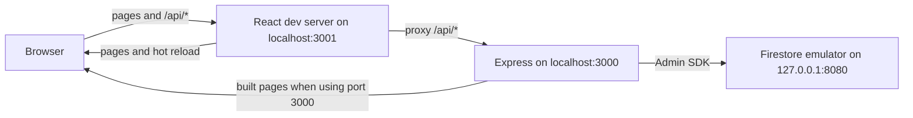
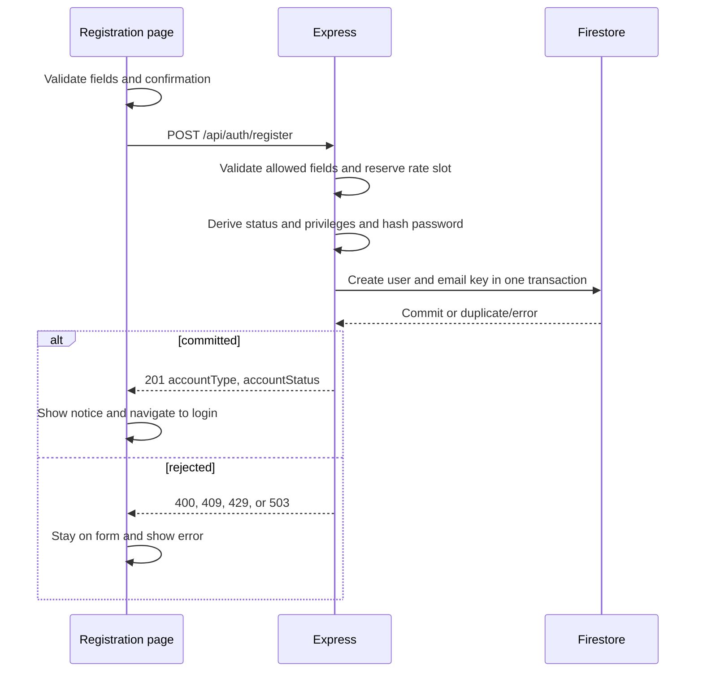
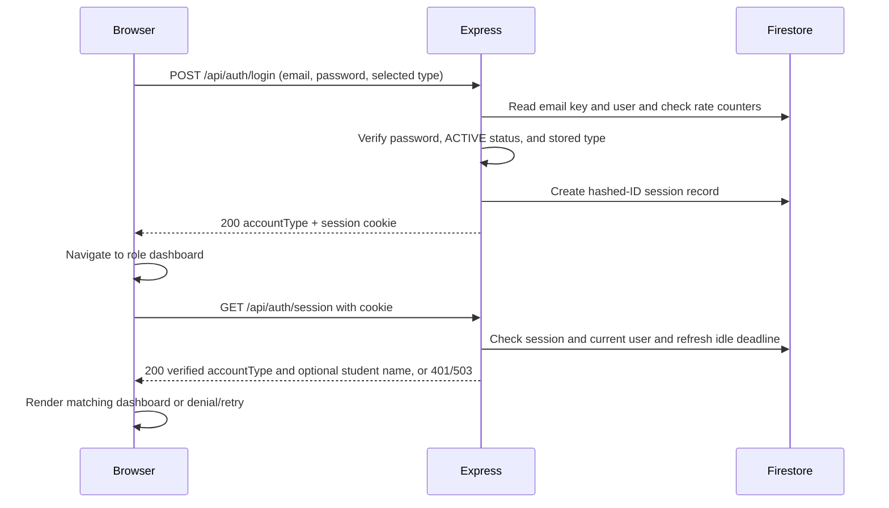

# Developer Guide

CodeClinic is a help desk for programming courses. Students submit coding
problems as tickets; TAs claim, answer, and resolve them; AI gives students
hints and helps TAs. `Overview.md` defines the product scope, and
`workflow/PLAN.md` orders the delivery work.

The project began with a library scope named LibConnect. Task evidence written
before 8 Nov 2026 still uses that name, the Member and Librarian account types,
and the former application path `src/libconnect-mp4`.

## Contents

- [Current application layout](#current-application-layout)
- [Running the development server](#running-the-development-server)
- [Registration and account records](#registration-and-account-records)
- [Login, sessions, and dashboard access](#login-sessions-and-dashboard-access)
- [Student ticket creation](#student-ticket-creation)
- [Student ticket activity](#student-ticket-activity)
- [Student My Tickets](#student-my-tickets)
- [Student Bug FAQ](#student-bug-faq)
- [Student ticket help chat](#student-ticket-help-chat)
- [Account management](#account-management)
- [Notifications](#notifications)
- [TA ticket queue](#ta-ticket-queue)
- [Shared AI gateway](#shared-ai-gateway)
- [TA AI assist](#ta-ai-assist)
- [Running the production server](#running-the-production-server)
- [Design of shared components](#design-of-shared-components)
- [Security design](#security-design)
- [Environments and deployment](#environments-and-deployment)
- [Multi-agent development workflow](#multi-agent-development-workflow)
- [Context engineering and resource-aware use](#context-engineering-and-resource-aware-use)
- [Repository and workflow files](#repository-and-workflow-files)
- [Acknowledgements](#acknowledgements)

## Current application layout

`src/codeclinic` contains the React and TypeScript frontend (`src/`), the Express API (`server/`), and the tests (`test/`). Under `server/`, `auth/` holds registration, login, sessions, and the Firestore-backed authentication store; `account/` holds own-account updates and account support; `notifications/` holds the shared notification writer and inbox API; `tickets/` holds the Student ticket and TA queue routes and stores; `shared/` holds the Firestore rate counter; and `ai/` holds the AI gateway's configuration, feature registry, prompt construction, secret redaction, rate limits, and usage store. Student ticket help and TA AI features use the gateway (see [Student ticket help chat](#student-ticket-help-chat) and [TA AI assist](#ta-ai-assist)). Express serves the built frontend on the same origin as `/api/auth/*`. During development, the React server provides hot reload and proxies API calls to Express. Authentication runs through Express with Firebase Admin and Firestore; the browser does not connect to Firestore directly.



## Running the development server

Install Node.js 24.12 or newer (the `engines` field in `package.json`; it also supports `node --env-file`), npm, and the Firebase CLI. Run the following commands from `src/codeclinic` in PowerShell. Install the locked npm dependencies once:

```powershell
npm ci
```

Use three terminals. Start the local Firestore emulator first:

```powershell
firebase emulators:start --only firestore --project demo-codeclinic
```

The `demo-` prefix marks an emulator-only project ID, so the Firebase tools cannot reach a cloud project with it. For Express, create a local `.env` file in `src/codeclinic` containing:

```dotenv
CODECLINIC_FIRESTORE_MODE=local-emulator
CODECLINIC_FIRESTORE_PROJECT_ID=demo-codeclinic
FIRESTORE_EMULATOR_HOST=127.0.0.1:8080
```

Keep `.env` out of Git and do not put production credentials in it. In the second terminal, wait until the emulator is listening on port 8080, then build the frontend and start Express on port 3000:

```powershell
npm run build
node --env-file=.env server/index.js
```

The `--env-file=.env` flag is required; `node server/index.js` does not load the file automatically. In the third terminal, run React with hot reload on port 3001:

```powershell
$env:PORT = '3001'
npm start
```

Open `http://localhost:3001/` for login or `http://localhost:3001/register` for registration. After signing in, a Student lands on `/student/dashboard` and a TA on `/ta/dashboard`. The React development server proxies `/api` requests to Express on port 3000. You can use `http://localhost:3000/` to view the built app without hot reload. Express uses only the local Firestore emulator, where accounts, sessions, and rate counters are stored; emulator data can disappear when it stops. If the emulator, project settings, or frontend build are missing or wrong, Express stops before accepting requests. The [application README](../src/codeclinic/README.md#run-locally) also shows a setup using PowerShell environment variables instead of `.env`.

### Verify the local setup

From `src/codeclinic`, run the regular tests and build:

```powershell
$env:CI = 'true'
npm test -- --watch=false --runInBand
npm run build
```

For the opt-in Firestore integration test, first start the emulator and set the three local Firestore variables shown above in the test terminal. Then run:

```powershell
$env:RUN_FIRESTORE_EMULATOR_TESTS = '1'
npm test -- --watch=false --runInBand --runTestsByPath test/firestore-mode.integration.test.js
```

## Registration and account records

The `/register` form accepts a Student or TA account. It collects name, email, password, and password confirmation; TA also requires a self-entered employee ID. The confirmation stays in the browser. Client validation gives field errors, and `POST /api/auth/register` repeats validation on the server. Registration email is trimmed and checked for one `@`, nonempty dot-separated segments, at least two domain labels, and no whitespace. The server accepts only the expected fields, uses an 8 KiB JSON limit, and limits registrations to five attempts per 15 minutes per direct source address.

The server hashes the exact password with Argon2id and generates the user ID, registration time, status, and privileges. In one Firestore transaction it creates `users/{userId}` and `emailKeys/{sha256(trimmed-lowercase-email)}`; a duplicate canonical email fails without a partial account. A Student starts `ACTIVE` with `studentId = userId`. A TA starts `INACTIVE` with `isManager = false` and needs activation by a TA Coordinator before sign-in. No TA Coordinator registration option exists. Stored records that still hold the former `MEMBER` or `LIBRARIAN` types or a `memberId` are treated as malformed and fail closed. A successful `201` contains only account type and status and creates no session. The page shows a success notice and returns to login after five seconds or via an immediate link.



## Login, sessions, and dashboard access

The login form posts email, password, and the selected Student or TA type to `POST /api/auth/login`. Express trims and lowercases the email for lookup, reads the email-key and user records, verifies the Argon2id hash, and requires an `ACTIVE` account whose stored type matches the selected type. A wrong email or password returns a generic `401`, so the response does not reveal whether an account exists. Only after the password is verified can the response name the reason: `403` with `ACCOUNT_INACTIVE` for an inactive account, or `WRONG_ACCOUNT_TYPE` with the stored type when the selected type is wrong. These outcomes still count as failed attempts and create no session. Login attempts are limited to five per canonical email and 30 per direct source address in a 15-minute window, and going over returns `429`. Storage errors return `503`.

On success, Express creates a Firestore `loginSessions` record and sends an HttpOnly, Secure, SameSite=Lax `__Host-codeclinic_session` cookie. Firestore stores the hash of the session ID, not the raw cookie value. The `200` response contains the server-verified account type, which the client uses to navigate to `/student/dashboard` or `/ta/dashboard`. One `sendAppShell` handler serves the listed SPA routes for dashboards, tickets, accounts, support, the TA queue, and notifications; the former `/member/dashboard` and `/librarian/dashboard` paths are not served or redirected.

Every dashboard load calls `GET /api/auth/session` before rendering the dashboard. Express checks the cookie, session, current user status, and current role against the role recorded at session creation. For an active Student, the response can also contain the stored name, which the dashboard uses in its greeting. Sessions expire after 30 minutes idle or eight hours absolute; successful validation refreshes the idle deadline. A `401` sends the visitor to login, a verified role mismatch shows access denied with a link to the correct dashboard, and a service or network failure shows a retry state without dashboard content. The guard accepts only a server-returned `STUDENT` or `TA` type; any other value shows the retry state. The React route guard controls only what is displayed; each protected account, notification, ticket, and AI API independently enforces server-side authorization.

## Student ticket creation

`TicketCreatePage` is protected by the session route guard at
`/student/tickets/new`; the dashboard's **Ask for Help** section and Student
header link navigate to that route. The form validates
required text, the seven fixed language choices, up to five trimmed lowercase
unique tags, optional source context, and the approved text and byte limits.
Source context is either up to three local UTF-8 text files (24 KiB each) or a
public GitHub URL with relative file paths. `TicketCreatePage` checks each
selected file's basename and byte size before reading it, strictly decodes the
bytes as UTF-8, and keeps accepted content in page memory. It displays filename
and size metadata and supports removal; it does not offer filename/content
paste controls or use browser storage. A rejected selection preserves earlier
accepted files. Ticket submission and create-page help-chat sends are blocked
while a file read is pending. Before the browser requests a CSRF token, it also
checks the serialized JSON body against 128 KiB and source-method exclusivity.
The browser submits the existing `files: [{ filename, content }]` shape to
`POST /api/tickets`; file-size display metadata is not sent. It never reads or
writes the ticket collection directly.

The ticket router independently checks the cookie-backed session, reloads the
active Student account, checks CSRF, parses at most 128 KiB, and validates the
request, including the three-file and 24 KiB per-file text limits and source
exclusivity. Client checks are early feedback only.
`createFirestoreTicketStore` generates the Firestore document ID and writes
one C1 `OPEN` document at `tickets/{ticketId}`. The stored record contains the
server-derived owner, Firestore `Timestamp` values, null initial claim and
resolution fields, and empty arrays/null values for absent optional fields.
Repository URLs are stored as references and are not fetched. Creation does
not create a persisted notification. A successful `201` lets the client return
to the Student dashboard with transient confirmation; failures remain on the
form. Active dashboard cards, ticket details, Student replies, and Student
close are described in [Student ticket activity](#student-ticket-activity).
Editing and TA transitions are outside this implementation.

Focused UI, API, and storage checks are in `test/StudentTickets.test.tsx`,
`test/student-tickets.api.test.js`, and `test/student-tickets.storage.test.js`.
The storage test verifies the exact C1 document shape and Firestore timestamp
types; it uses a controlled Firestore interface. The earlier creation emulator
assertion is recorded in `workflow/tasks/student-tickets/implementation-T04.md`.



Logout first calls `GET /api/auth/csrf` to rotate and obtain a token, then sends that token in `X-CSRF-Token` with `POST /api/auth/logout`. Express compares the token hash, deletes the session, and clears the cookie on `204`. The UI returns to login after `204` or a confirmed unauthenticated `401`; on an unconfirmed error it hides dashboard content and offers a retry.

The local Firestore collections used by these flows are `users`, `emailKeys`, `loginSessions`, and `loginFailureCounters`. Only server code creates or changes their authentication records.

## Student ticket activity

`DashboardRouteGuard` protects `/student/tickets` and
`/student/tickets/:ticketId` on direct entry and refresh. Express serves the
SPA shell for the detail path; the browser guard checks the cookie-backed
session before either ticket page renders. My Tickets loads the list only
after the guard succeeds and requests each page from the server.

`GET /api/tickets/active` derives the owner from the verified current Student
account, queries only `OPEN` and `CLAIMED` records, orders by descending
`updatedAt` and ascending `ticketId`, and limits results to five. The composite
Firestore index is defined in `firestore.indexes.json` and wired from
`firebase.json`. Deploying that index is a separate operation.

`GET /api/tickets/:ticketId` checks ownership before returning the safe ticket
projection or reply data. Replies are ordered by `createdAt` and `replyId` and
returned in blocks of 50. A bounded opaque cursor identifies the next page;
each request checks the session and ticket ownership again. Author names come
from trusted account records, with `[deleted account]` for a missing owner
author. `TicketDetailPage` preserves earlier replies when another block fails,
renders text literally, and distinguishes Student and TA messages with role
labels and layout.

Reply and close requests require a session-bound CSRF token. Reply writes trim
surrounding whitespace and update ticket `updatedAt` in the same transaction.
Close transitions only active owned tickets to `CLOSED`, clears claim and
resolution fields, and re-reads state transactionally. The client reports
success only after server confirmation and reloads state after a conflict.

## Student My Tickets

The protected `/student/tickets` page replaces the former placeholder. The
Student header places **My Tickets** immediately after **Create Ticket**; the
dashboard keeps the **View all tickets** link. `MyTicketsPage` defaults to the
Open view (`OPEN` and `CLAIMED`) and switches to Closed (`CLOSED` and
`RESOLVED`) with buttons that expose their selected state through
`aria-pressed`. Both views use `StudentTicketCard`, the same card component as
the dashboard. Closed-view cards use its muted style while keeping readable
status labels and visible keyboard focus. Each card opens the existing owned
ticket detail route.

`GET /api/tickets?view=open|closed&cursor=...` rechecks the active Student
account and derives the owner from the session on every request. It returns
only ticket ID, title, language, concept tags, status, and update time. Each
bounded page returns up to 20 summaries, ordered by descending `updatedAt`
then ascending `ticketId`; an opaque cursor is bound to the selected view.
Switching views discards the previous results and cursor. Initial and
additional-page errors offer Retry, while a failed additional page keeps
already loaded cards visible. The list query requires the composite index on
`studentId`, `status`, `updatedAt`, and `ticketId` in
`firestore.indexes.json`. Production index deployment is separate from
application code and must precede production use of this query.

## Student Bug FAQ

`StudentBugFaq` is mounted below Ask for Help on `/student/dashboard`. It
searches across ticket owners only when the stored status is `RESOLVED`.
Students choose `title` or `tags`; the backend normalizes the query and scans
at most 100 ordered ticket documents per request to return at most 20 matching
summaries. A summary contains only title, concept tags, and a session-bound
encrypted FAQ reference. The UI does not display the reference or any ticket
or owner identifier.

`GET /api/tickets/faq?q=...&field=title|tags&cursor=...` and
`GET /api/tickets/faq/:faqRef?cursor=...` require an authenticated active
Student. The server rechecks the account and resolved status on each request.
The detail projection contains title, concept tags, fix note, and a page of up
to 50 valid replies. Speaker labels are derived as `Student` or `TA` from
trusted account records; message text is returned literally, so names typed in
message bodies can remain visible. The detail view is read-only.

FAQ references and search/reply cursors use bounded AES-256-GCM tokens derived
from the trusted session hash, Student identity, purpose, and query/reference
binding. Tokens are not persisted. The ordered search requires the composite
index on `status` ascending, `createdAt` descending, and `__name__` ascending
in `firestore.indexes.json`. The replies query also uses the configured
`createdAt`/`replyId` ordering. Index configuration is present in the
repository; production deployment and readiness have not been verified here.

Synthetic store and HTTP contract checks in
`test/bug-faq.store.contract.test.js` and
`test/bug-faq.api.contract.test.js` cover all four ticket statuses, different
owners, bounded sparse/dense search pages, cursor type preservation, detail
projection, resolved-only rechecks, reply pagination, authorization and
session binding. `test/StudentBugFaq.test.tsx` covers dashboard placement,
search selection, result projection, stale requests, and detail pagination.
These controlled tests do not connect to a live Firestore project.

Focused My Tickets checks are in `test/StudentMyTickets.test.tsx`,
`test/StudentTicketCard.test.tsx`, and
`test/student-my-tickets.contract.test.js`. The synthetic emulator integration
below covers both views, all four statuses, pagination, and owner isolation.

Run the synthetic Firestore Emulator integration from `src/codeclinic` with the
emulator at `127.0.0.1:8080` and these variables set in the test shell:

```powershell
$env:RUN_FIRESTORE_EMULATOR_TESTS = '1'
$env:FIRESTORE_EMULATOR_HOST = '127.0.0.1:8080'
$env:CODECLINIC_FIRESTORE_MODE = 'local-emulator'
$env:CODECLINIC_FIRESTORE_PROJECT_ID = 'demo-codeclinic'
npm test -- --watchAll=false --runInBand --runTestsByPath test/student-ticket-activity.emulator.test.js
```

The integration creates synthetic local users, sessions, tickets, and replies,
then deletes those records. It covers ownership isolation, the indexed five
ticket query, both My Tickets views with all four statuses, tied-time page
boundaries across 20-item pages for two Students, a 50+1 reply boundary, a
reply and dashboard refresh, close field semantics, and concurrent close
attempts. It does not access a live project or deploy index configuration.

## Student ticket help chat

Spec: [`workflow/specs/ai-error-explainer.md`](../workflow/specs/ai-error-explainer.md)
v0.6. `src/tickets/StudentHelpChat.tsx` and its stylesheet render a small
lower-right opener and messaging-style side popup on `/student/tickets/new`
and an owned `/student/tickets/:ticketId` after its authorized load. The popup
has a stable header, left bot/right Student messages, a scrollable conversation,
and a bottom composer. The component keeps at most four prior exchanges in
React memory, clears on page unmount or refresh, and does not use browser
storage. It renders replies as text. Create-page suggestions never populate
form fields; no chat action submits or updates a ticket.

`server/index.js` registers `ERROR_EXPLAINER` on the shared gateway and mounts
the Student router through `server/tickets/route.js`. The two read-only POST
endpoints are `/api/tickets/help-chat` for an unsubmitted create draft and
`/api/tickets/:ticketId/help-chat` for an owned ticket. Both require a current
Student session and CSRF; the detail route checks ownership before reading replies or calling the
provider. Request bodies accept a question and up to eight alternating prior
turns. The create route also requires a complete snapshot of every current
draft field, including empty fields and attached file content; the detail
route rejects a client-supplied draft. JSON bodies are capped at 128 KiB.

The detail route pages through eligible replies from the owner and the
currently assigned TA, rather than relying on the first 50 replies displayed
in the UI. It checks the context cap and fails closed if assignment changes
during the scan. `server/ai/student-ticket-help.js` fixes the prompt and exact
`HINT`, create-only `REFINEMENT`, `CLARIFICATION`, and `REFUSAL` JSON shapes.
The gateway redacts common secret patterns, caps the complete post-redaction
input at 98,304 UTF-16 code units, requests at most 1,024 output tokens, and
rejects malformed or unsafe output. A rejected reply maps to a safe
`AI_INVALID_OUTPUT` 503; the client retains the question for retry. No model
output can authorize a write. The provisional limits have not been confirmed
against the deployed model, and the reported Create Ticket wording 503 has no
observed live-provider retry result. The later T11/T12 correction clarified
the fixed Student prompt's prohibited output categories and its grounded
concept-hint path. Fake-provider tests and independent review passed; the
change did not establish the cause of the live `AI_INVALID_OUTPUT` response.

Focused verification uses injected fake providers and synthetic ticket data.
From `src/codeclinic`, run:

```powershell
$env:CI = 'true'
npm test -- --watchAll=false --runInBand --runTestsByPath test/student-help-chat.api.test.js test/student-ticket-help.feature.test.js test/StudentTicketHelpChat.test.tsx test/StudentHelpChat.test.tsx test/ai-gateway.test.js
npm run build
```

The Batch 7 implementation and independent review each passed these five
suites (127 tests) and the build. The human also verified the popup on both
Student pages at 320 × 640 CSS pixels and confirmed screen-reader message
labels and status announcements. See
[`implementation-report.md`](../workflow/tasks/ai-error-explainer/implementation-report.md)
and [`security-review-T08.md`](../workflow/tasks/ai-error-explainer/security-review-T08.md)
for evidence and remaining risks. Live provider calls require separate human
authorization; local tests do not establish deployed-model compatibility.

## Account management

The server mounts `server/account/routes.js` under `/api`. It provides
`GET /api/account`, `PATCH /api/account/profile`, `POST /api/account/password`,
and the list/status/password-reset endpoints under `/api/support/accounts`.
Every mutation requires the current server CSRF token. Authorization loads the
actor and target records; browser role and manager fields have no authority.
TAs support Students; Coordinators also support other TAs.

Email changes move the canonical `emailKeys` reservation atomically. Password
changes and support resets use Argon2id; a successful self-service change
preserves the caller's session and deletes the others. Deactivation and reset
delete the target's sessions. Reset returns a new 16-character temporary
password once with `Cache-Control: no-store`, stores only its hash, and sets
`mustChangePassword`.

Temporary-password sessions may access only session lookup, CSRF retrieval,
logout, and the own-password-change endpoint. Every other protected API,
including notifications, returns `403 PASSWORD_CHANGE_REQUIRED`. The browser
routes the owner to `/account/password-change` until the change succeeds.

Shared UI routes are `/student/account`, `/ta/account`, `/ta/students`,
`/ta/tas`, and `/account/password-change`. The Express server serves the SPA
shell for direct navigation and refresh. These pages add shared account
functionality; role-owned ticket and AI features remain separate tasks.

### First TA Coordinator

A human administrator first registers a TA account, then runs
`scripts/bootstrap-coordinator.js` with an explicit `--project` and supplies the
existing TA email through `CODECLINIC_COORDINATOR_EMAIL`. For local synthetic
data only, with the Firestore emulator already running:

```sh
FIRESTORE_EMULATOR_HOST=127.0.0.1:8080 CODECLINIC_COORDINATOR_EMAIL=existing-ta@example.test node scripts/bootstrap-coordinator.js --project demo-codeclinic
```

The script promotes the matching existing TA to `isManager: true` and `ACTIVE`.
It refuses a Student, missing account, or an existing Coordinator unless
`--allow-additional` is explicitly supplied. It prints outcomes without the
full email or credentials. Production bootstrap is a human administrator's
operation; agents do not run this script against a cloud project. Never reuse
production credentials for local development.

## Notifications

`server/notifications/notify.js` is the sole shared notification writer. Ticket
owners call `notify` from authorized server operations; the inbox has no
client-facing creation endpoint. Failed writes retry once and never roll back
the calling operation. Event/recipient decisions belong to the ticket tasks.

The four `/api/notifications` endpoints list the caller's notifications, count
unread items (maximum 99), mark one read, and mark all read. Mutations require
CSRF; another user's item ID returns the same `404` as a missing item. Messages
are plain text. `NotificationBell` appears in the shared `AppHeader`, and
`/notifications` renders the session-checked inbox. `NotificationsRoute`
supplies `/ta/tickets/:ticketId` links for TA viewers; opening a linked item
marks it as read. Student notifications remain text with a mark-read action.
The TA ticket routes call `notify` after successful claim, reply, and resolve
commits, sending the Student `TICKET_CLAIMED`, `TICKET_REPLY`, or
`TICKET_RESOLVED`; unclaim sends none. A notification failure does not roll
back the ticket action.

The list query needs a Firestore composite index on `recipientUserId` ascending
and `createdAt` descending. It is defined in `firestore.indexes.json`, and
`test/ta-tickets.indexes.test.js` checks the query against that definition.
The local emulator does not enforce index creation. The production workflow
can deploy the index after the required setup; live index readiness was not
verified for this guide update.

## TA ticket queue

Spec: `workflow/specs/ta-ticket-queue.md`. The shared ticket data contract
(collections, field rules, and the state machine) is
[section C of the spec](../workflow/specs/ta-ticket-queue.md#c-shared-ticket-data-contract-student-owner-agreed-2026-11-09);
`student-tickets` uses the same contract.

Modules in `server/tickets/`:

| Module | Responsibility |
| --- | --- |
| `constants.js` | Statuses, languages, size limits, concept-tag validation |
| `transitions.js` | Pure state-machine guard (`evaluateTransition`) |
| `store.js` | In-memory and Firestore ticket stores (list, get, claim, unclaim, resolve, reply) |
| `ta-routes.js` | Router: auth, queue list, ticket detail; mounts the two below |
| `ta-claims.js` | Claim, unclaim, and resolve routes and their notifications |
| `ta-replies.js` | Reply route and notification |
| `ta-views.js` | Maps stored tickets and replies to client views, without internal IDs |

The UI is `src/TAQueuePage.tsx` (`/ta/queue`) and `src/TATicketPage.tsx`
(`/ta/tickets/:ticketId`).

All endpoints require an active TA session; every `POST` also requires CSRF.
Unknown body keys return `400`.

| Method and path | Purpose |
| --- | --- |
| `GET /api/ta/tickets?status=&language=&concept=&cursor=` | Queue page of 20, oldest first |
| `GET /api/ta/tickets/:ticketId` | Ticket detail with up to 200 replies |
| `POST /api/ta/tickets/:ticketId/claim` | `OPEN` to `CLAIMED` |
| `POST /api/ta/tickets/:ticketId/unclaim` | `CLAIMED` to `OPEN`, claiming TA only |
| `POST /api/ta/tickets/:ticketId/replies` | Add a reply (`message`) |
| `POST /api/ta/tickets/:ticketId/resolve` | `CLAIMED` to `RESOLVED` (`fixNote`), claiming TA only |

Every transition runs in a Firestore transaction that re-reads `status` and
`claimedByTaId`, so two concurrent claims leave one winner and the other gets
`409`. Views omit `studentId`, `claimedByTaId`, and email addresses.

After a successful commit, claim, TA reply, and resolve call `notify` for the
ticket's student (`TICKET_CLAIMED`, `TICKET_REPLY`, `TICKET_RESOLVED`).
Unclaiming sends nothing. A notification failure never rolls back the action.

`server/index.js` builds the ticket store lazily (`createLazyTicketStore`).
The Firestore store loads `firebase-admin/firestore` when it is created, so
building it on first use keeps `createServerApp` constructible with the fake
databases used by unit tests.

Run the emulator-backed integration test from `src/codeclinic` (needs the
Firebase CLI and Java); it is skipped unless `RUN_FIRESTORE_EMULATOR_TESTS=1`:

```bash
CI=true RUN_FIRESTORE_EMULATOR_TESTS=1 FIRESTORE_EMULATOR_HOST=127.0.0.1:8080 CODECLINIC_FIRESTORE_MODE=local-emulator CODECLINIC_FIRESTORE_PROJECT_ID=demo-codeclinic \
firebase emulators:exec --only firestore --project demo-codeclinic "npm test -- --watch=false --runInBand --runTestsByPath test/ta-ticket-queue-emulator.integration.test.js"
```

## Shared AI gateway

`server/ai/gateway.js` composes the approved units and exposes
`createAiGateway(deps)` with `register(definition)` and
`run({ feature, actor, input })`. The startup instance is available at
`app.locals.aiGateway`. Calling features must first authenticate and authorize
the actor and data in trusted server code. The gateway itself exposes no HTTP endpoint;
the Student ticket help chat and TA AI features register on it (see
[Student ticket help chat](#student-ticket-help-chat) and
[TA AI assist](#ta-ai-assist)).

Configuration is read once from the server environment. Missing or malformed
`SOCLAAS_API_KEY`, `SOCLAAS_BASE_URL`, or `SOCLAAS_MODEL` disables the gateway
without stopping the server. Tests use fakes. Do not place keys in browser
configuration or logs. In production, `apphosting.yaml` supplies
`SOCLAAS_API_KEY` and `SOCLAAS_BASE_URL` from Secret Manager and `SOCLAAS_MODEL`
as a plain value, at runtime only (see
[Environments and deployment](#environments-and-deployment)).

Calls first build, redact and size-check the user content. Oversized input is
rejected without truncation, and common secrets and email addresses are
redacted. Only a request that passes these checks reserves shared Firestore
limits (5/user/minute, 50/user/day, and a global default of 40/minute,
configurable up to 45), so a rejected request never uses up quota (spec R4
and R5, v0.2). Prompts put fixed system instructions before delimited user
data. The provider transport has a
20-second attempt timeout, one bounded retry, a circuit breaker, redirect
refusal, and a 1 MiB response cap. Output must pass JSON and feature-schema
validation. Logs and `aiUsage` store metadata and numeric token counts only.

Redaction can miss secrets: users must never paste credentials. Model output
is advisory and cannot authorize writes or invoke tools. Automated tests
and CI use fakes and never call the provider. The TA AI task records a human-run
[live SoCLaaS test](#live-soclaas-test-opt-in). Student chat's deployed-model
response and `max_tokens` compatibility still require a separately authorized
smoke check.

## TA AI assist

Spec: `workflow/specs/ai-ta-assist.md`. Two TA features run on the shared AI
gateway: a fix-note drafter and queue insights. Model output is advisory and
shown as plain text; it never changes ticket state.

Modules in `server/tickets/`:

| Module | Responsibility |
| --- | --- |
| `ta-ai-shared.js` | R5 error mapping (`toAiErrorResponse`), `buildAliasMap`, `cleanInsightGroups`, `errorSummary`, the empty-JSON-body check |
| `ta-ai-fix-note.js` | `FIX_NOTE_DRAFTER` definition: prompt, `buildUserContent`, `parse` (`{ draft }`, 1-2000 characters) |
| `ta-ai-insights.js` | `QUEUE_INSIGHTS` definition (`parse`: 0-8 groups) and the in-memory cache |
| `ta-ai-draft-route.js` | The draft route and `registerTaAiFeatures(gateway)` |
| `ta-ai-insights-route.js` | The insights route |

`startServer()` in `server/index.js` creates the gateway
(`app.locals.aiGateway`) and calls `registerTaAiFeatures` on it. `ta-routes.js`
mounts both routes after the TA guard. The routes read `req.app.locals.aiGateway`
per request, so a missing or disabled gateway gives `AI_UNAVAILABLE`.

Both endpoints require an active TA session and CSRF, take an empty JSON body
(anything else is `400`), and write nothing.

| Method and path | Rules | Success response |
| --- | --- | --- |
| `POST /api/ta/tickets/:ticketId/fix-note-draft` | `404` if missing; `409` unless the ticket is `CLAIMED` by the requesting TA (same rule as resolve) | `200 { draft }` |
| `POST /api/ta/tickets/insights` | Oldest 60 active tickets; none gives `200` without a gateway call | `200 { groups: [{ label, kind, summary, tickets: [{ ticketId, title }] }], ticketCount, truncated, cached }` |

Gateway errors map to `{ code, message }` with no provider detail:
`AI_UNAVAILABLE` 503, `AI_RATE_LIMITED` 429, `AI_INPUT_TOO_LARGE` 422,
`AI_INVALID_OUTPUT` 502. The message texts are in `ta-ai-shared.js`.

**Aliases.** For insights the server numbers the tickets `T1`...`Tn` (oldest
first) and sends only `alias | language | conceptTags | title | error summary`
lines (the error summary is the first non-empty error line, up to 160
characters). The model answers with aliases. The server maps them back to
tickets from a per-request map and drops unknown aliases, repeats (the first
group wins), and empty groups. Real ticket IDs are never sent, and model text
cannot introduce or select a ticket.

**Cache.** A successful insights result is kept for 5 minutes, per router
instance, in memory. The key is the ordered alias map (alias, ticket ID, and
`updatedAt` per ticket) plus `truncated`, so any ticket change or a different
truncation state makes a new call. Failures are not cached. With several server
instances each has its own cache, so the same queue can cause one call per
instance; losing the cache is harmless.

**Never sent to the model:** student or TA names, email addresses, user IDs,
real `ticketId`s, `claimedByTaId`, session or CSRF data, `repoUrl`,
`repoFilePaths`, and tickets outside the request. The drafter labels replies
only `STUDENT` or `TA`, with the role taken from the stored account. Redaction
in the gateway can miss secrets, so users must not paste them into tickets.

UI: `TATicketPage.tsx` has the **Draft with AI** button (claimer of a `CLAIMED`
ticket only; it fills the Fix note, never submits, and confirms before
replacing text). `TAQueuePage.tsx` has the **Queue insights** panel.

### Live SoCLaaS test (opt-in)

`test/ta-ai-live-soclaas.integration.test.js` runs both features against the
real SoCLaaS API with synthetic tickets, an in-memory store, and a stub `db`
(at most 4 provider calls). It checks shape and safety, not wording. It is run
by a human only, never by an agent or in CI, and skips otherwise.

Put the settings in `src/codeclinic/.env` (gitignored). Use `.env`, not
`.env.local`: CRA's test runner does not load `.env.local`. Use placeholders
here and your own values locally:

```text
SOCLAAS_API_KEY=<your key>
SOCLAAS_BASE_URL=https://<host>/v1
SOCLAAS_MODEL=<model id>
AI_GLOBAL_LIMIT_PER_MINUTE=<optional, 1-45>
```

`SOCLAAS_BASE_URL` must be https and end in `/v1`. Run from `src/codeclinic`:

```bash
RUN_SOCLAAS_TESTS=1 CI=true npx react-scripts test --roots test --testMatch '**/test/**/*.test.*' --watchAll=false ta-ai-live
```

The test file uses a custom Jest environment,
`test/helpers/live-fetch-environment.js`. CRA's Jest 27 `node` environment has
no `fetch`, so the real transport would report `AI_UNAVAILABLE` without
reaching the provider. The environment copies the host Node's `fetch` and web
helpers into the test context; production is unaffected.

A `503` whose provider message is "no healthy provider backends" means a
provider-side outage for that model, not a code fault. Try another model from
`GET /models`. Do not paste keys, prompts, or responses into issues or logs.

## Running the production server

Production runs on Firebase App Hosting (Cloud Run) in project
`libconnect-mp4`. The production URL recorded in deployment evidence is
<https://libconnect-mp4--libconnect-mp4.asia-southeast1.hosted.app/>.
`src/codeclinic/apphosting.yaml` defines the build (`npm run build`), the start
command (`node server/index.js`), and these environment variables:

| Variable | Value | Available at |
| --- | --- | --- |
| `CODECLINIC_FIRESTORE_MODE` | `production` | Build and runtime |
| `CODECLINIC_FIRESTORE_PROJECT_ID`, `GOOGLE_CLOUD_PROJECT` | `libconnect-mp4` | Build and runtime |
| `SOCLAAS_API_KEY`, `SOCLAAS_BASE_URL` | Secret Manager secrets | Runtime only |
| `SOCLAAS_MODEL` | Model name | Runtime only |

Cloud Run supplies `PORT` and `K_SERVICE`, and the backend's service account
supplies Firestore credentials. Do not set `FIRESTORE_EMULATOR_HOST` or
`GOOGLE_APPLICATION_CREDENTIALS` in production. The server rejects a local
gcloud Application Default Credentials file. Before accepting requests, it also
checks that the Cloud Run metadata project matches
`CODECLINIC_FIRESTORE_PROJECT_ID`. Missing or inconsistent configuration stops
startup instead of switching Firestore targets, so production mode fails on a
developer laptop by design. The repository contains no credentials.

Only `express`, `argon2`, `firebase-admin`, `react`, `react-dom` and
`web-vitals` are runtime dependencies. Build and test tooling (`react-scripts`,
`typescript`, the testing libraries and type packages) is in `devDependencies`.

The SoCLaaS key and base URL are referenced as runtime Secret Manager secrets
in `apphosting.yaml`; the AI gateway is unavailable if its configuration is
missing or invalid. This guide update does not verify the present app rollout,
live feature behavior, or Firestore index readiness.

**Caching.** Express serves the app shell (`/`, `/register`, and the listed SPA
routes) through one `sendAppShell` handler. It sends `Cache-Control: no-cache`
and a content-derived ETag. Content-hashed `/static/*` files are
`public, max-age=31536000, immutable`, and other build files are `no-cache`.
App Hosting builds files with the same 1980 modification time, so the default
size-and-time ETag could remain unchanged across releases. `test/server.test.js`
covers the cache headers and revalidation behavior.

## Design of shared components

Shared server code is split by responsibility so each feature reuses one implementation of each concern:

| Component | File | Responsibility | Used by |
| --- | --- | --- | --- |
| Firestore target selection | `server/firestore-target.js` | Chooses the emulator or production Firestore once at startup and fails closed on inconsistent configuration | `server/index.js` |
| Auth store | `server/auth/firestore-store.js` | Reads and writes users, email keys, sessions, and rate counters | Login, session checks, registration rate limits |
| Email canonicalization | `server/auth/email.js` (`canonicalizeEmail`, `emailKeyFor`) | One rule for email lookup keys | Login and registration |
| Registration persistence | `server/auth/firestore-registration.js` | Atomic user and email-key creation | Registration |
| Firestore rate counter | `server/shared/firestore-rate-counter.js` | Fixed-window counters stored in Firestore | Auth store and AI gateway rate limits |
| Shared theme | `src/theme.css` | Design tokens and reusable visual classes | Every page |
| Dashboard logout | `src/DashboardLogout.tsx` | One logout flow with CSRF handling | Both dashboards |
| AI gateway | `server/ai/` | Server-only configuration, redaction and caps, stable prompts, Firestore rate limits, bounded provider transport, schema validation, and safe usage records | Student help chat and TA AI features |
| TA AI helpers | `server/tickets/ta-ai-shared.js` | One error mapping, alias map, insight-group cleaning and error summary for both TA AI routes | Fix-note draft and queue insights routes |
| App shell serving | `server/index.js` (`sendAppShell`, `setStaticCacheHeaders`) | One handler for every SPA route, and the cache policy for built files | All page routes |
| Shared header | `src/AppHeader.tsx` | Role-aware navigation, notification bell and logout | Every signed-in page |
| Account support | `server/account/` | Own-profile/password updates and server-authorized support operations | Account and support pages |
| Notifications | `server/notifications/`, `src/notifications/` | Shared writer, own-user inbox API, bell and plain-text inbox | Both dashboards |

Known issue: `server/auth/login.js` still re-exports the email helpers from `server/auth/email.js` for one frontend test import. The re-export can be removed once that test imports `email.js` directly.

The remaining planned shared components are described in [`workflow/PLAN.md`](../workflow/PLAN.md#planned-design-details).

## Security design

Implemented security controls:

- The Express server is the only authority for identity, role, status, and manager privilege. Client-supplied roles, IDs, statuses, and manager flags are rejected or ignored.
- Passwords are hashed with Argon2id. Responses, logs, and test evidence never contain passwords, hashes, or session IDs.
- Sessions use a `__Host-` cookie that is HttpOnly, Secure, and SameSite=Lax, store only a hash of the session ID, expire after 30 minutes idle or eight hours, and recheck the account on every protected request.
- Logout requires a CSRF token.
- Login and registration are rate limited, and failures use generic messages that do not reveal whether an account exists.
- The browser never accesses Firestore directly. `firestore.rules` denies every client read and write, and *Deploy production* deploys it; the server's Admin SDK is not subject to the rules.

The shared AI gateway is created once at server startup, including when
configuration is missing; a disabled gateway returns `AI_UNAVAILABLE` while
the rest of the server continues. Student chat routes enforce server-side
session, Student role, CSRF, and owned-ticket checks before provider use. The
model has no tools, and its output cannot create, update, or reply to a ticket.
The finite output filter and pattern redaction reduce risk but cannot
guarantee against semantic solution leakage or unknown secret formats.

AI security controls for the TA features ([TA AI assist](#ta-ai-assist)):

- AI routes require an active TA session and CSRF, and accept only an empty JSON body. The fix-note draft is limited to the TA who claimed the ticket. The routes write nothing.
- Prompts keep fixed system instructions before delimited, redacted and size-capped ticket data. Names, emails, user IDs, real ticket IDs, and repository URLs and file paths are never sent. Insights use per-request aliases, so model text cannot select a ticket.
- Model output must pass JSON and schema validation and is shown as plain text labelled **AI suggestion**. It never changes a ticket.
- Rate limits are shared in Firestore: 5 per user per minute, 50 per user per day, and a global limit under the SoCLaaS quota. The transport has timeouts, one bounded retry and a circuit breaker.
- Errors map to fixed codes with no provider detail.

Development-process security:

- The CI workflow audits production dependencies at `high` severity and scans the full Git history with Gitleaks.
- Reviewed false positives are allowlisted by exact fingerprint in `.gitleaksignore`.
- Production deployment needs a team member's approval of the `production` GitHub environment. It signs in through Workload Identity Federation, so no Google Cloud key is stored in GitHub. The identity provider accepts tokens only from this repository, and the deploy service account holds only the roles needed for indexes.
- No agent or CI job holds the SoCLaaS key. Only the human-run live test uses it, from a local, gitignored `.env`.

## Environments and deployment

Spec: `workflow/specs/environments-and-deployment.md` v0.3.

| Environment | Firebase project | Firestore mode | Data | How it runs |
| --- | --- | --- | --- | --- |
| Development | `demo-codeclinic` (emulator only) | `local-emulator` | Synthetic, disposable | On each developer's machine ([Running the development server](#running-the-development-server)) |
| Production | `libconnect-mp4` | `production` | Real users | Firebase App Hosting, with rollouts reported from `main` |

The `.firebaserc` `default` alias is the emulator-only `demo-codeclinic`; its
`prod` alias is `libconnect-mp4`. `firestore-target.js` fails closed on mixed
settings. There is no separate deployed development backend.

**CI** (`.github/workflows/ci.yml`) runs on pull requests and pushes to `main`.
It installs dependencies, runs tests and a build, audits production dependencies
at high severity, and scans Git history for secrets. It requests read-only
repository permissions, pins actions to commit SHAs, and cancels superseded
runs. It does not deploy.

**Deploy production** (`.github/workflows/deploy-prod.yml`) is configured to
run after successful CI on a push to `main`, or manually from `main`. The deploy
job waits for approval of the `production` GitHub environment, checks out the
commit that passed CI, and uses Workload Identity Federation. It deploys the
deny-all Firestore rules and configured indexes without deleting absent
production indexes, then lists production indexes. A read-only smoke check
expects `/` and `/register` to return HTML with status 200 and
`/api/auth/session` to return 401. One-time human setup is documented in
[`deploy-prod-setup.md`](../workflow/tasks/environments-and-deployment/deploy-prod-setup.md).
The repository defines the workflow but does not show whether its production
identity, approval environment, rules, or indexes have been configured and
deployed successfully.

App Hosting's GitHub integration is reported to roll out the app automatically
from `main`. The Firestore workflow does not deploy the app; moving that rollout
behind its approval gate remains a gap against specification R6. A GitHub
branch-protection ruleset is outside this repository, so its current settings
cannot be confirmed from these files.

## Multi-agent development workflow

Every non-trivial feature follows spec-driven development: **specify → plan/tasks → implement → review → human merge decision**, with an explicit human approval at each gate. Specialized agents are defined in `workflow/agents/`:

| Agent | Role | Configured model and effort |
| --- | --- | --- |
| `analyst` | Writes the specification, task checklist, and handoff | `gpt-6-luna`, high |
| `orchestrator` | Coordinates test writing, ordered batches, implementers, and review; owns checklist updates | `gpt-6-sol`, high |
| `test_writer` | Writes tests from the approved specification before implementation | `gpt-6-luna`, medium |
| `implementer` | Implements one approved batch of up to two tasks in order and records evidence for each | `gpt-6-luna`, medium |
| `reviewer` | Independently reviews each batch item and their combined change from a separate worktree | `gpt-6-luna`, high |

These profiles configure the Codex agents. The TA features (`ta-ticket-queue`, `ai-ta-assist`) were built in Claude Code with the same roles mapped to Claude models by difficulty: Haiku for task grouping, Sonnet for test writing and implementation, and Opus for orchestration and independent review. The per-task logs in [`logs/chat/jiali/`](../logs/chat/jiali/) record this.

The orchestrator proposes consecutive batches of up to two checklist items in dependency order and obtains human approval before dispatch. One implementer completes and verifies each item before starting the next; a different reviewer checks each item and their combined behavior before the next batch. Batch manifests under `workflow/tasks/<task-id>/` are checked by `src/workflow/validate-assignment.mjs`. Agents receive artifact paths rather than pasted documents, verify approval state before acting, and cannot approve their own work. The OpenSpec toolkit skills (`.agents/skills/openspec-*`) are installed. A path adapter maps them to `workflow/specs/` so the project keeps a single specification tree. `workflow/README.md` defines the lifecycle, handoff rules, permission matrix, and evidence requirements.

## Context engineering and resource-aware use

In the development process:

- **Paths instead of pasted documents:** handoffs pass artifact paths and versions, so agents read only the sections they need (`workflow/README.md`, *Context and evidence budget*).
- **One primary record per fact:** reports link to factual logs instead of copying them.
- **Model choice by role:** the orchestrator and reviewer run at high reasoning effort; routine roles run at medium.
- **Skill pruning:** on 8 Nov 2026, nine skills unrelated to the stack (mobile, analytics, Data Connect, and others) were removed from `.agents/skills/`. This cut the skill descriptions loaded into every agent session from 7,269 to 4,446 characters (−39%) and removed about 361 KB of reference files. See `logs/tasks/codeclinic-scope/skills-pruning.md`.

In the app, AI calls run only after a user requests a Student hint or a TA AI
feature. Provider configuration is optional; without it, these features return
safe unavailable states while the rest of the app remains usable.

The TA AI features call SoCLaaS through the shared gateway. Fixed system prompts come before the delimited ticket data, input is capped and output limited by `max_tokens`, and queue insights send one short line per ticket and are cached for 5 minutes. See [Shared AI gateway](#shared-ai-gateway) and [TA AI assist](#ta-ai-assist).

## Repository and workflow files

| Path | Contents |
| --- | --- |
| `AGENTS.md` | Repository-wide agent instructions: source-of-truth order, approval protocol, security baseline, and boundaries |
| `Overview.md` | Product scope, user stories, data model, and AI security constraints |
| `workflow/README.md` | Workflow lifecycle, task layout, context budget, handoff rules, and permission matrix |
| `workflow/PLAN.md` | Feature dependency order and ownership |
| `workflow/agents/*.toml` | Specialized agent profiles: mission, model, reasoning effort, and instructions |
| `workflow/specs/*.md` | Canonical feature specifications |
| `workflow/tasks/<task-id>/` | Per-task evidence: spec reference, `tasks.md` checklist, `handoff.md`, implementation and review reports, test coverage reports, security review, and visual evidence |
| `workflow/tasks/ai-gateway/design.md` | SoC LLM adapter design reused from MP3: provider contract, five-layer reliability pipeline, error handling, and the 90 requests/minute provider limit |
| `workflow/tasks/<task-id>/assignment-batch-*.json` | Orchestrator dispatch records for a task's batches |
| `src/workflow/validate-assignment.mjs` | Checks batch manifest structure and evidence paths; does not grant approval or verify test truth |
| `.github/workflows/ci.yml` | CI: tests and build, production dependency audit, and Gitleaks secret scan (see [Environments and deployment](#environments-and-deployment)) |
| `.gitleaksignore` | Exact fingerprints of reviewed Gitleaks false positives, each with its reason |
| `.github/workflows/deploy-prod.yml` | Approved production deployment of Firestore rules and indexes, with smoke checks |
| `src/codeclinic/firestore.rules` | Firestore security rules that deny all client access |
| `workflow/tasks/environments-and-deployment/deploy-prod-setup.md` | One-time human setup for the deploy workflow: Workload Identity Federation, the `production` environment and repository variables |
| `workflow/tasks/<task-id>/execution_logs/` | Legacy location for factual logs from earlier tasks |
| `logs/tasks/<task-id>/` | Factual execution logs: commands, results, and agent run notes |
| `logs/chat/<name>/` | Chat summaries produced with the `summarise-chat` skill and checked by the developer |
| `.agents/skills/` | Project skills: Firebase and Firestore references, OpenSpec SDD skills, Git conventions, and chat summarisation |
| `skills-lock.json` | Source and hash of each installed external skill |
| `openspec/` | OpenSpec toolkit configuration; specifications live in `workflow/specs/` instead |
| `docs/` | User Guide, Developer Guide, Reflections, and the GitHub Pages product website |

## Acknowledgements

- Workflow documents reused from the team's MP3:
  - `AGENTS.md` and the first version of `Overview.md` came from commit `72b0063` (*Add documentation from MP3*).
  - The SoC LLM adapter design in `workflow/tasks/ai-gateway/design.md` (provider contract, five-layer reliability pipeline, error handling, and the 90 requests/minute limit) was first written for MP3.
- Firebase skills in `.agents/skills/` come from [`firebase/agent-skills`](https://github.com/firebase/agent-skills), as recorded in `skills-lock.json`.
- The `openspec-*` skills were generated by the OpenSpec CLI (version 1.16.0, MIT licence).
- The product website uses the Jekyll [minima](https://github.com/jekyll/minima) theme, and the guides render diagrams with [Mermaid](https://mermaid.js.org/).
- Code and documentation were written with assistance from OpenAI Codex and Anthropic Claude, as recorded in `logs/`.

<script type="module">
  import mermaid from "https://cdn.jsdelivr.net/npm/mermaid@11/dist/mermaid.esm.min.mjs";

  const diagrams = [...document.querySelectorAll("pre > code.language-mermaid")];
  const nodes = diagrams.map((code) => {
    const node = document.createElement("div");
    node.className = "mermaid";
    node.textContent = code.textContent;
    code.parentElement.replaceWith(node);
    return node;
  });

  mermaid.initialize({ startOnLoad: false });
  await mermaid.run({ nodes });
</script>
